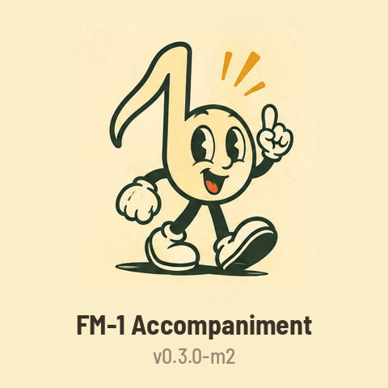
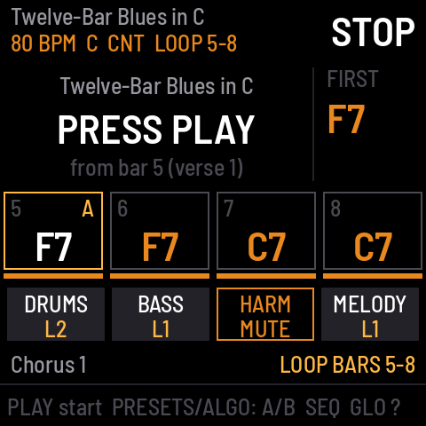

# Controls (M2)

The FM-1's panel, as M2 uses it. M1's map (2026-11-04) was the start; M2 adds what the user asked for after testing
M1 (D020: tempo in BPM, loops you can find, pause, the keys' octave) and the planning chat's rule from M1's lesson
(the user could not find section looping): **every screen shows a short legend of its controls, and GLO shows them
all**. New screens were drawn here first (mock-ups, `tools/mock_screens.py`), then built; the built screens are in
`docs/step-M2/` (emulator screenshots).

Kept: **REC is not used** (held at power-on: the chip's update mode). OCT− and OCT+ held *together* at power-on
stay fm1-base's panel set-up; after start-up they shift the keys' octave (D021). Nothing needs a button held at
start-up.

Panel, for orientation: left of the screen MASTER, SELECT (top row), PRESETS, ALGORITHM (second row), OCT− OCT+;
right of it K1–K4 (top), then two rows of buttons: FX SEL ENV LFO EDIT GLO / HOME SAVE ARP SEQ PLAY REC.

## Start-up

The splash: the logo (a placeholder: `firmware/assets/tmp-logo.jpg`, the one file to replace) with the name and
version, for at least 3 s; then the song list. The power-on checks (REC, OCT− + OCT+) come before it and are not
delayed.

## Song list

| Control | Does |
|---|---|
| SELECT (turn) | move the cursor |
| PLAY or EDIT | open the song (the play screen, stopped, at the song's own tempo) |
| GLO | the controls (help) |
| keys | Electric Piano 1 on channel 16; OCT− / OCT+ their octave |
| MASTER | volume |

No songs stored: the list says how to send them (`tools/fm1song.sh send songs/*`). A song that fails its check
when opened stays in the list with `SONG ERROR <reason> (send it again)`.

## Play screen

| Control | Does | Light |
|---|---|---|
| PLAY | stopped: play from the start point (count-in if on); playing: **pause**; paused: **go on** (count-in on: a bar of clicks, then from the paused bar's beat 1; off: from exactly where it paused) | flashes on every beat (bright on beat 1), count-in too |
| HOME | playing or paused: **stop**, back to the start point; stopped: back to the song list | |
| FX, SEL, ENV, LFO | mute / unmute drums, bass, harmony, melody, at any time | lit = the layer plays |
| K1, K2, K3, K4 (turn) | level (variant) of drums, bass, harmony, melody | |
| SELECT (turn) | tempo in **BPM**, 30–250, 1 BPM a click, 5 a click when turned quickly; amber when not the song's own; every song opens at its own | |
| PRESETS (turn) | the **start point** by section (each click: the next section; the section's pickup is kept). In LOOP BARS: bar **A** | |
| ALGORITHM (turn) | the start point by bar. In LOOP BARS: bar **B** | |
| SEQ | loop: off → **SECTION** (the section of the start point; while playing: the one playing) → **BARS A–B** (from the start bar, 4 bars to begin with) → **SONG** → off | lit = a loop is on |
| ARP | count-in on / off (default on) | lit = on |
| GLO | the controls (help); GLO again or any other button: back | |
| OCT−, OCT+ | the keys' octave, −3..+3 (shown for a moment) | lit = shifted that way |
| EDIT, SAVE | not used in M2 parts 1–2 (part 3: EDIT = the view) | |
| keys | Electric Piano 1 on channel 16, over the song | |
| MASTER | volume | |

**Start point and loops, together.** Where PLAY starts is the start point: the song's start until you turn PRESETS
(by section) or ALGORITHM (by bar). A loop starts there too: SECTION loops the section the start point is in, BARS
loops A–B (A is the start point's bar). With a loop on, PLAY starts at the loop's start. Turning PRESETS while
playing a section loop moves the loop to the next section: it jumps there at its next bar line. Pickups follow
docs/song-format.md 3.3: a section's pickup is played at its start, and the same beats are cut from the end of the
loop; bars A–B have no pickup.

 

 

Screen, top to bottom: title; tempo, key, CNT, the loop; `bar:beat` (or STOP, PAUSE, IN); the current chord large,
NEXT and a countdown (`IN 3`) in the last bar before a change; the bar strip (this bar and the next 3; no dimming of
a chord held over: the strip shows it is the same chord; an amber line under the bars of a loop, `A` on the start
bar); the beat cursor; the four layers (level `L1`/`L2`, amber `MUTE`); the section, the loop; **the legend**. The
CPU and voices line moved into the help screen.

## Why this map

- PLAY pauses, as on most players; stopping is HOME, the "go back" button, which goes one step further when already
  stopped (the list). "Stop and back to the top" is one press.
- SELECT, the big encoder, stays the tempo: the setting changed most while practising.
- PRESETS and ALGORITHM sit side by side under SELECT: left = A (or the coarse step, sections), right = B (or the
  fine step, bars).
- The layer buttons, K1–K4 above them and ARP / SEQ are as in M1 (the user has used them).
- GLO ("global") is the help: one press shows every control where it is on the panel.
