# Controls (M2; M3, M4 and M5 changes at the end)

**The current description of the controls is docs/reference.md (firmware 0.10.4). This file is the history, milestone by milestone.**

The FM-1's panel, as M2 uses it. M1's map (2026-11-04) was the start; M2 adds what the user asked for after testing
M1 (D020: tempo in BPM, loops you can find, pause, the keys' octave) and the planning chat's rule from M1's lesson
(the user could not find section looping): **every screen shows a short legend of its controls, and GLO shows them
all**. New screens were drawn here first (mock-ups, `tools/mock_screens.py`), then built; the built screens are in
`docs/step-M2/` (emulator screenshots).

Kept: **REC is not used** (held at power-on: the chip's update mode). OCT− and OCT+ held *together* at power-on
stay fm1-base's panel set-up; after start-up they shift the keys' octave (D021). Nothing needs a button held at
start-up.

Panel, for orientation: left of the screen MASTER, SELECT (top row), PRESETS, ALGORITHM (second row), OCT− OCT+;
right of it K1–K4 (top), then two rows of buttons: FX SEL ENV LFO EDIT GLO / HOME SAVE ARP SEQ PLAY REC.

## Start-up

The splash: the logo (a placeholder: `firmware/assets/tmp-logo.jpg`, the one file to replace) with the name and
version, for at least 3 s; then the song list. The power-on checks (REC, OCT− + OCT+) come before it and are not
delayed.


## Song list

| Control | Does |
|---|---|
| SELECT (turn) | move the cursor |
| PLAY or EDIT | open the song (the play screen, stopped, at the song's own tempo) |
| GLO | the controls (help) |
| keys | Electric Piano 1 on channel 16; OCT− / OCT+ their octave |
| MASTER | volume |

No songs stored: the list says how to send them (`tools/fm1song.sh send songs/*/`). A song that fails its check
when opened stays in the list with `SONG ERROR <reason> (send it again)`.

## Play screen

| Control | Does | Light |
|---|---|---|
| PLAY | stopped: play from the start point (count-in if on); playing: **pause**; paused: **go on** (count-in on: a bar of clicks, then from the paused bar's beat 1; off: from exactly where it paused) | flashes on every beat (bright on beat 1), count-in too |
| HOME | playing or paused: **stop**, back to the start point; stopped: back to the song list | |
| FX, SEL, ENV, LFO | mute / unmute drums, bass, harmony, melody, at any time | lit = the layer plays |
| K1, K2, K3, K4 (turn) | level (variant) of drums, bass, harmony, melody | |
| SELECT (turn) | tempo in **BPM**, 30–250, 1 BPM a click, 5 a click when turned quickly; amber when not the song's own; every song opens at its own | |
| PRESETS (turn) | the **start point** by section (each click: the next section; the section's pickup is kept). In LOOP BARS: bar **A** | |
| ALGORITHM (turn) | the start point by bar. In LOOP BARS: bar **B** | |
| SEQ | loop: off → **SECTION** (the section of the start point; while playing: the one playing) → **BARS A–B** (from the start bar, 4 bars to begin with) → **SONG** → off | lit = a loop is on |
| ARP | count-in on / off (default on) | lit = on |
| GLO | the controls (help); GLO again or any other button: back | |
| OCT−, OCT+ | the keys' octave, −3..+3 (shown for a moment) | lit = shifted that way |
| EDIT | the view: **chord** → **keyboard** → **chart** (part 3) | |
| SAVE | the **KEY** mode (part 3): SELECT changes the key, a semitone a click, through all twelve (the music moves the nearest way: at most 5 down or 6 up, so bass and melody stay in their range); SAVE again, or 4 s without a turn: back to the tempo. Every song opens in its own key | |
| keys | Electric Piano 1 on channel 16, over the song | |
| MASTER | volume | |

**Start point and loops, together.** Where PLAY starts is the start point: the song's start until you turn PRESETS
(by section) or ALGORITHM (by bar). A loop starts there too: SECTION loops the section the start point is in, BARS
loops A–B (A is the start point's bar). With a loop on, PLAY starts at the loop's start. Turning PRESETS while
playing a section loop moves the loop to the next section: it jumps there at its next bar line. Pickups follow
docs/song-format.md 3.3: a section's pickup is played at its start, and the same beats are cut from the end of the
loop; bars A–B have no pickup.

 

 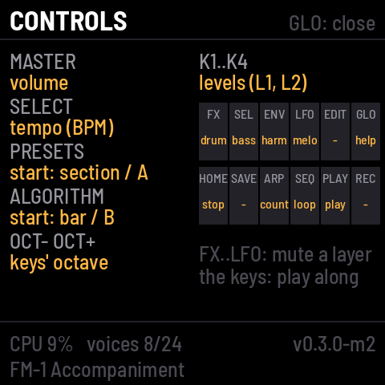

Screen, top to bottom: title; tempo, key, CNT, the loop; `bar:beat` (or STOP, PAUSE, IN); the current chord large,
NEXT and a countdown (`IN 3`) in the last bar before a change; the bar strip (this bar and the next 3; no dimming of
a chord held over: the strip shows it is the same chord; an amber line under the bars of a loop, `A` on the start
bar); the beat cursor; the four layers (level `L1`/`L2`, amber `MUTE`); the section, the loop; **the legend**. The
CPU and voices line moved into the help screen.

## Part 3: the part you play (views, key, cue, bass, key lights)

**The part you play** is the muted one of harmony and bass: harmony muted → you play the chords; bass muted (harmony
playing) → you play the bass; **both muted → harmony wins** (the bass notes are still named on the status line).
That is a proposal (plan-M2 G asked for one): one rule for the rhythm cue and the key lights, nothing to set.

- **Key (SAVE, then SELECT).** The whole band but the drums moves; the chord names, the key name and the bass
  names are spelled for the new key (sharps or flats by its signature: F# in D, Gb in Db; C major mixed); the top
  line shows `A (+2)`, amber. A key change while playing ends the sounding notes at once (no note hangs at the old
  pitch).
- **Chord view** (as M1/M2, plus): left of the big chord, the **rhythm cue**: a note symbol for how long the part's
  attack lasts at the chosen level (whole, half, quarter, eighth, sixteenth; read from the song's own events for
  that level), bright for a moment at each attack, grey between; `L1`/`L2` under it. Shown when harmony or bass is
  muted.
- **Keyboard view**: the chord, `next … IN n`, and a keyboard C3–B5 with the chord's keys lit (the voicing of the
  harmony's level: L1 root position, L2 the inversions that move least), the next chord's keys outlined in the last
  bar before it, the bass note amber when the bass is muted.
- **Chart view**: the section's bars (16 a page) with their chords, the bar now framed.
- **Bass names** (the bass muted): the status line shows `BASS C3  then G2` (the note now and the next, in the key
  now, following the bass level).
- **Key lights**: the FM-1's own keys light for the part you play, while playing (and in the count-in, paused):
  harmony → the chord's keys (the level's voicing) bright and the next chord's keys dim in the last bar before a
  change; bass → the bass note. Folded into the 27 keys (F3–G5) and following OCT− / OCT+ (the lit keys are where
  those notes are under your hands). Keys you press light as ever.

 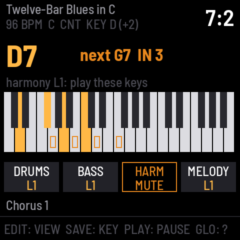

 

## Why this map

- PLAY pauses, as on most players; stopping is HOME, the "go back" button, which goes one step further when already
  stopped (the list). "Stop and back to the top" is one press.
- SELECT, the big encoder, stays the tempo: the setting changed most while practising.
- PRESETS and ALGORITHM sit side by side under SELECT: left = A (or the coarse step, sections), right = B (or the
  fine step, bars).
- The layer buttons, K1–K4 above them and ARP / SEQ are as in M1 (the user has used them).
- GLO ("global") is the help: one press shows every control where it is on the panel.
- EDIT ("edit what you see") changes the view; SAVE was free and the key is a setting you set and keep for the song
  (the legend says `SAVE: KEY`). A shift (hold GLO + turn) was rejected: GLO opens the help on its press.

## M3 (docs/plan-M3.md), part by part

### Part 1: bug fixes

- **Beat light:** PLAY flashes at full brightness on every beat, for 220 ms on beat 1 and 110 ms on the others.
  M2's mid-level flash on beats 2.. was not visible on the unit.
- **Loop marks:** the strip repeats a loop's bars after its end (it shows the bars as they will be heard). The A and
  B marks are now drawn only on the bars in song order, so there is one A and one B.
- **Start bar after a loop:** setting LOOP BARS (A and B) no longer moves the start point. With the loop off, PLAY
  starts where the start point was set before, and the bottom line says so only if it was set.
- **Count-in in the keyboard and chart views:** the count replaces the view while it counts in, as the chord view
  does.

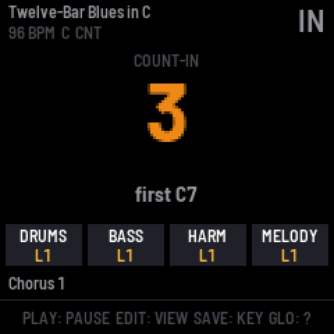 

### Part 2: "follow your part" (all four layers), blinking in rhythm

- **Your part** is the muted layer. The top line says so (`BASS - YOURS`), and its box in the layers row says
  YOURS with a double frame. The screen, the rhythm cue, the key lights and the views (EDIT) follow it:
  - **harmony:** the chord (as before);
  - **bass:** the bass note with its octave, the next note, the chord under it; the strip and chart show each bar's
    bass notes;
  - **melody:** the melody note, the next one, the chord; the bars' notes;
  - **drums:** the hit now (KICK, SNARE, ...; another sound of the same hit under the next), the next hit; the strip
    and chart show each bar as a small grid (kick, snare, cymbals, others). Drums have no keyboard view: EDIT skips
    it.
- **Several muted (proposal):** your part is the one muted last. Unmute it and the one muted before takes over. No
  extra control is needed, and the YOURS box shows which one is followed. The M2 "harmony wins" rule is gone.
- **Nothing muted:** the harmony is shown as before (with its cue), and the keys stay dark.
- **Key lights:** your part's keys flash bright at each of its attacks at its level, and stay at the middle
  brightness between attacks. The harmony's next chord is dim in the last bar before it. Drums: no key lights (the
  beat light is enough). The keyboard view does the same: bright amber at an attack, darker amber between, the next
  outlined.
- **Rhythm cue:** always shown (not only when muted), right of the big name, half its M2 height, no level label (the
  layers row has the level).
- Each part remembers its last view (EDIT).

Mock-ups (drawn first):  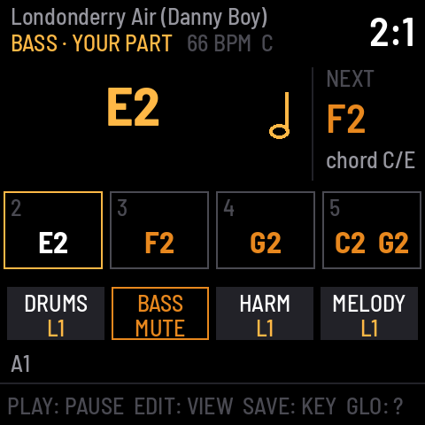
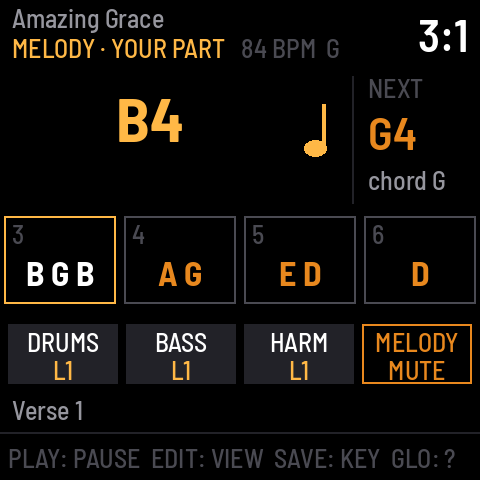  

Built (emulator):  
  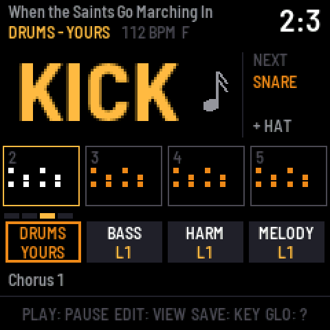
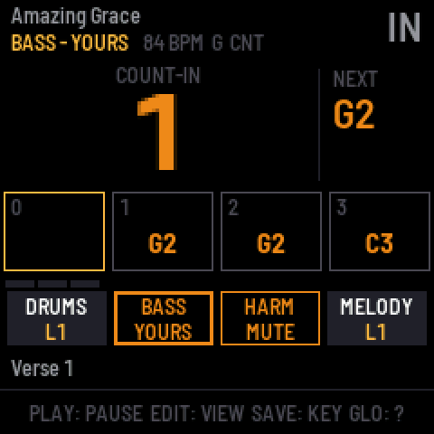 

### Part 3: loops redesigned (bars A–B only)

- **One kind of loop:** bars A–B. M2's section loop and whole-song loop are gone: a section is A..B with PRESETS (it
  jumps to section edges), and the whole song is A at the first bar, B at the last.
- **Setting it, step by step** (the legend and a badge on the top line say what to do at each step):
  1. **SEQ:** "LOOP: SET A". A starts at the bar playing (or the start point, stopped). ALGORITHM moves A by a bar,
     PRESETS to a section's first bar.
  2. **SEQ:** A is set; "LOOP: SET B". B starts 4 bars on. ALGORITHM moves it (never before A), PRESETS to a
     section's last bar.
  3. **SEQ:** B is set and the loop is on. Playing outside it, the music jumps in at the next bar line.
  - **HOME** while setting: from B back to A; from A, cancelled (no loop).
  - **SEQ with the loop on:** the loop is off. Nothing else changes it, so there is no hidden state. PRESETS and
    ALGORITHM say "SEQ: OFF FIRST".
- **Shown:** the loop's bars are filled (dark amber) on the strip and the chart, with a line under them, a small A on
  bar A and a small B on bar B. The bar being moved has a white frame. There is exactly one A and one B: the marks
  are only on bars in song order, not on the strip's repeated copies after the loop's end. While A and B are being
  set the loop is not on yet.
- **Start points:** with the loop off, PRESETS = start from a section, ALGORITHM = start from a bar, as before. With
  the loop on, PLAY starts at A (on its beat 1, no pickup).

Mock-ups:  


Built: 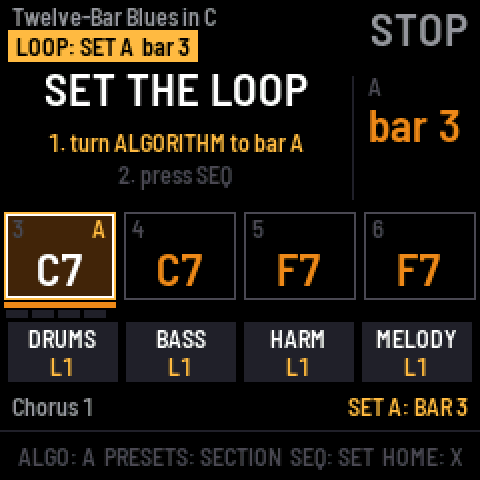 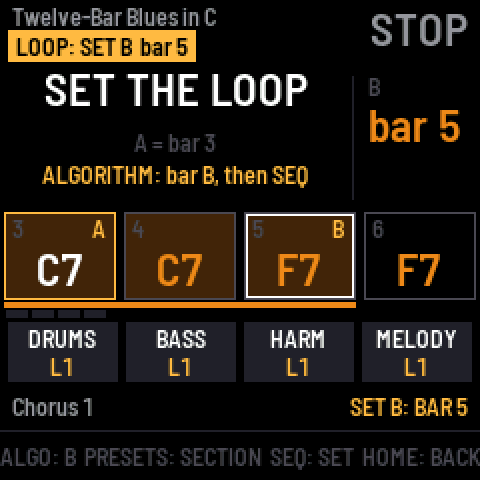 

### Part 4: screen polish, count-in, inversion label, settings

- **Legend:** button names in amber, actions in gray, a thin divider between pairs (`PLAY pause | EDIT view | ...`),
  on every screen. If a legend is too wide it uses the smaller font.
- **No section row:** the space goes to the views (144 rows, from y 32 to 176). The layers row moves down to 180.
  The start point (`FROM 3`) and the loop (`LOOP 5-8`) are on the top line. The section's name is still in the
  stopped screen and the chart view.
- **Inversion line** (chord view, under the strip): the voicing at the harmony's level, e.g. `C/E, 1st inversion`
  or `G7, root position`, with `L1 root pos.` or `L2 inversions` on the right. For another part: its chord and
  level. The keyboard view has the same line under the keys.
  - Level 1 is always root position; level 2 voice-leads through inversions. On Amazing Grace, 19 of 29 chords at
    level 2 are in an inversion.
- **Keyboard view, zoomed:** 11 white keys (about 1.5 octaves), 21 px each. The window follows your part's notes:
  it moves only when a note now or next would fall outside, with a key to spare. Notes show at their real pitch.
- **Count-in in every view:** the count (and the first chord or note) replaces the view while it counts in. This
  covers the chord, keyboard and chart views, and the later views use the same path.
- **Count-in sound:** a beep on a channel the song does not use: square lead, C6 on beat 1 and G5 on the others,
  70 ms. Its peak is 21x M2's wood-block clicks (7725 against 362 at MASTER 100 %). With no free channel it falls
  back to M2's clicks.
- **Settings (GLO, then GLO again):**
  - SELECT picks a row; ALGORITHM, PLAY or EDIT change its value; GLO or HOME go back and save.
  - The rows: key lights blink ON/OFF; count-in length 1 or 2 BARS; count-in volume LOW, MEDIUM or HIGH (the
    beep's channel volume 64, 96 or 127); note names under the notation ON/OFF (Part 7). Guide volume comes in
    Part 8.
  - Saved in fm1-base's settings store (OBJ_SETTINGS, two copies at 0xFC000 and 0xFD000, the newer valid one wins),
    only when something changed. The stock firmware never uses these sectors: they are all 0xFF in our unit's
    stock dump.
- **Help:** "GLO again: settings".

Mock-ups: 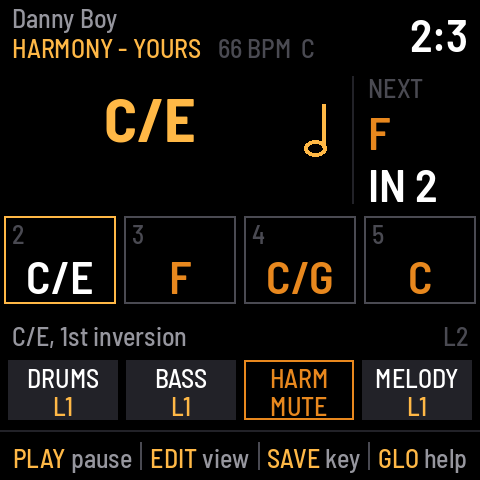 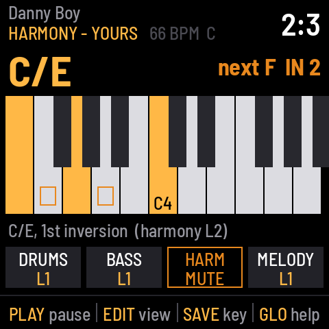


Built: 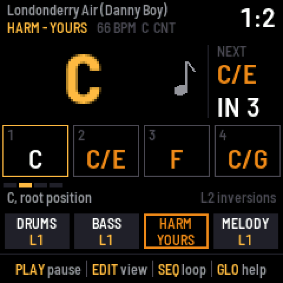 
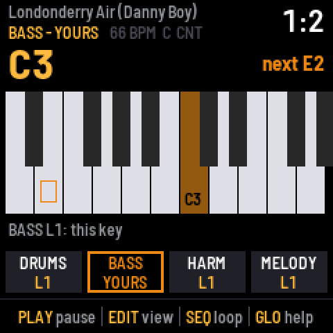 


### Part 5: Happy Birthday

Nothing new on the screen: the song is in the list (p5-list.png) and plays from its two-note pickup.

### Part 6: instrument views (guitar chord boxes, bass tab)

EDIT now goes through **each part's own list of views** (the main view first):

| your part | views (EDIT) |
|---|---|
| harmony | chord, keyboard, chart, **guitar** |
| bass | bass note, keyboard, chart, **bass tab**, notation (Part 7) |
| melody | melody note, keyboard, chart, roll and notation (Part 7) |
| drums | the hits, chart, drum grid (Part 7) |

- **Guitar (harmony):**
  - A chord box for the chord now: 6 strings (low E on the left), 4 frets, the dots with finger numbers, o (open)
    and x (not played) above the nut, a barre drawn as a bar. Up the neck, "3fr" marks the first fret. The next
    chord is a small box on the right.
  - Our own table (firmware/app/guitar.h): 53 standard open shapes, slash chords among them (C/E, D/F#, G/B ...),
    and barre shapes for any root from E-form and A-form templates (major, m, 7, m7, maj7, sus4), the lower fret
    of the two.
  - It follows key changes, matching by pitch class, so C# and Db are the same shape. A slash chord with no shape
    of its own shows the plain chord's shape and "the bass plays E".
  - A chord with no shape says "no shape in our table" and lists its notes.
  - tools/guitar_check.py checks every shape's notes against its chord. All the songs' chords, in all 12 keys, find
    a shape (216: 98 open, 82 barre, 36 without their slash bass).
- **Bass tab (bass):**
  - 4 strings (G at the top), the bass part at its level, scrolling to an amber now line. The tab uses the shared
    scrolling engine (Part 7 adds its views to it).
  - Each note is a fret number on the string it is played on (the highest string it is on, the lowest fret), with a
    line for how long it lasts and its name under the tab. Played notes are dim, the sounding one white, coming ones
    amber.
  - About 1.5 bars are on the screen, with bar numbers. Redrawn for every pixel the song moves; the audio is not
    disturbed (the Blues at 250 BPM in this view: on time, no deferred block, CPU at most 14 %).

Mock-ups: 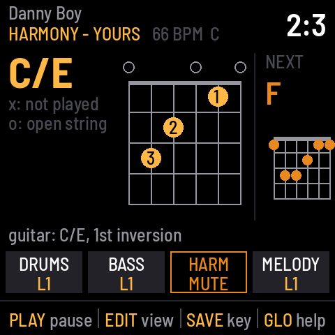 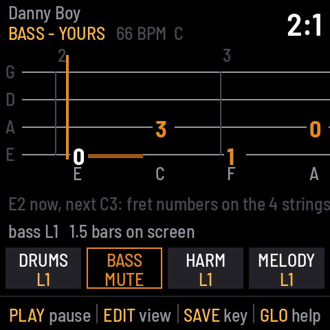

Built:  


### Part 7: scrolling views (one shared engine, a now line)

All scrolling views share Part 6's engine: the song moves right to left past an amber now line, with bar lines and
beat ticks, and is redrawn for every pixel it moves. The count-in replaces them while it counts, as in every view.

- **Melody roll (melody):**
  - the melody's notes are bars sliding to the line, higher notes higher (the song's melody range at its level, in
    the key now, fills the height);
  - each bar has its name above it, and the chords are along the top;
  - played notes are dim, the sounding one bright, coming ones amber.
- **Notation (melody: treble clef; bass: bass clef), D025, after the approved mock
  (docs/m3-design/notation-mock.png):**
  - one staff with the clef (the mock's treble clef curve; a drawn bass clef with its two dots), the key signature
    and bar lines;
  - noteheads, hollow from a half note up; stems (up below the middle line, down above it); dots; beams for eighth
    pairs on a beat and its "and"; a flag for a lone eighth; ledger lines;
  - accidentals where the note differs from the key signature: sharp, flat or natural;
  - chord names above (the sounding one amber); note names under the staff (setting "Note names", on by default);
  - played notes dim, the sounding one amber, coming ones white;
  - simplifications, as D025 says: each note is drawn as the nearest of whole, dotted half, half, dotted quarter,
    quarter or eighth; no ties, no rests; two notes at once in the part: the first.
  - It follows key changes: Greensleeves at +5 gets one flat.
- **Drum grid (drums):** rows KICK, SNARE, HATS (hi-hats and cymbals), OTHER. The hits are blocks sliding to the line
  at the drums' level; a loud hit is brighter.
- **Zoom (setting "Scrolling views show"):** 1.5 BARS (the default) or 3 BARS, for all the scrolling views (the
  notation at 36 px a beat, or 18).
- The audio is not disturbed: the whole Blues at 250 BPM in the drum grid or the notation is on time, with no
  deferred block and CPU at most 15 %.

Mock-ups: 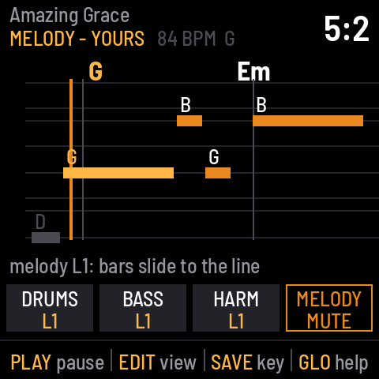 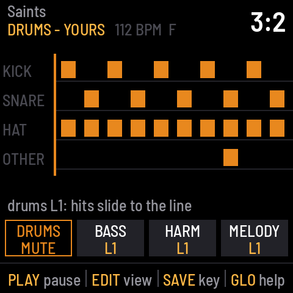; notation: the planning
chat's 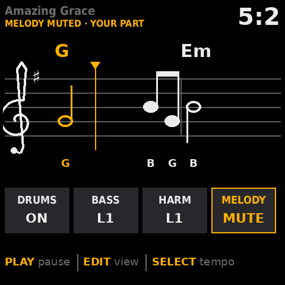

Built: 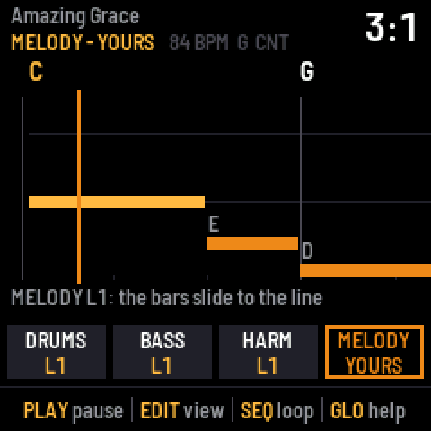 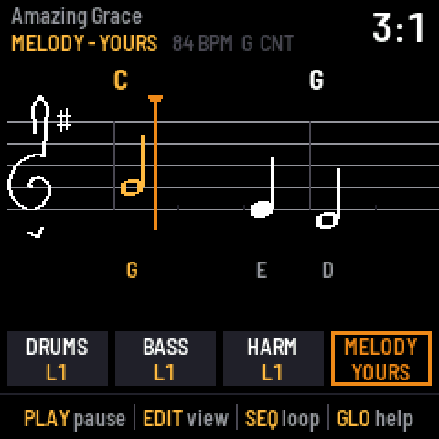
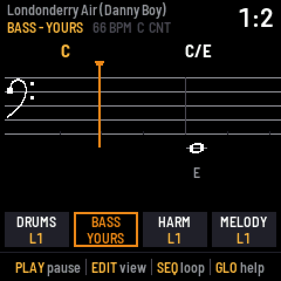 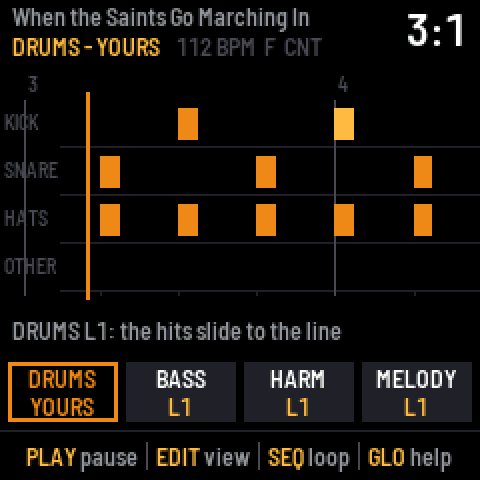
 

### Part 8: song folders, guide volume

- **Folders (categories):**
  - `category:` in song.yaml (format 1.2) puts each song in a folder. The list opens in **All songs** (as before:
    SELECT, PLAY), and **HOME on the list goes up to the folders**: All songs, then the categories in alphabetical
    order, each with its count. PLAY opens one.
  - Songs without a category (an older 1.1 or 1.0 file, or none given) are in **Other**.
  - Ours: Hymns (Amazing Grace, Saints), Folk (Greensleeves, Danny Boy, Oh! Susanna, Scarborough Fair), Blues,
    Practice forms (Four Chords), Celebrations (Happy Birthday).
  - The FM-1 reads 1.0, 1.1 and 1.2. `fm1song send` asks which versions an FM-1 reads; an M2 FM-1 (up to 1.1) gets
    1.1, without the category. A fallback to M2 needs no special step.
- **Guide volume (setting "Guide (your part)": OFF / 15 % / 30 %):**
  - your part, muted, plays quietly instead of silent, so you can lean on it while learning. Other muted layers stay
    silent;
  - the layers row says GUIDE instead of YOURS;
  - EAS's loudness goes roughly with the square of the velocity, so the velocities are scaled by the square root
    (x 0.39 / x 0.55). In the emulator, 30 % gives 18 % of the part's own level (about −15 dB).

Built: 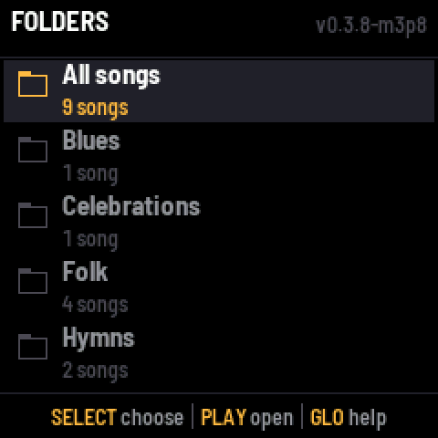 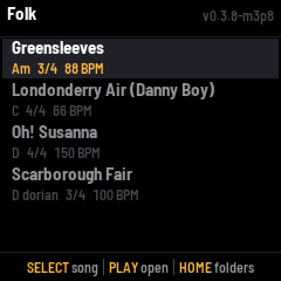 


## M4 (docs/plan-M4.md), part by part

### Part 1: quick fixes

- **Count-in volume:** the default is now MEDIUM. A value already saved in the settings stays as it is.
- **The whole-song loop is back** (the user's note), as the first step of SEQ:

  | SEQ press | loop |
  |---|---|
  | 1st (loop off) | **LOOP SONG**: at the end the song goes round again from its first note |
  | 2nd | the song loop off; set A |
  | 3rd | set B: the A–B loop is on |
  | 4th | off |

  With the song loop on, PRESETS and ALGORITHM still set the start point. The top line says `LOOP SONG`, and the
  legend says `SEQ set A-B`.
- **Help on the list** now says `HOME folders`.

 

### Part 2: "your part" chosen on purpose (D027)

- **Hold a layer button (FX drums, SEL bass, ENV harmony, LFO melody) for about a second:** that layer becomes your
  part. The top line (`BASS - YOURS`), the big name, the rhythm cue, the key lights and the views follow it,
  **muted or not**. A song opens with the harmony as your part. This replaces M3's "the last one muted".
- **Press a layer button:** its volume cycles **FULL → QUIET → MUTED → FULL**.
  - QUIET plays the layer at the quiet level (setting: 25 % or 50 %, default 50 %). M3's guide volume became this,
    and it works for any layer, not only your part.
  - A press is acted on when the button is released, and only if it was not held.
- **Layer boxes:** the level and FULL or QUIET (QUIET on a darker fill), or MUTE (an amber frame). Your part has an
  amber bar on top and a double frame.
- **Settings:** "Quiet level" 25 % / 50 % and the new "Key lights" ON / OFF (blinking stays a separate setting). There
  are now 7 rows.
- Drums as your part: no key lights.

Mock-up: 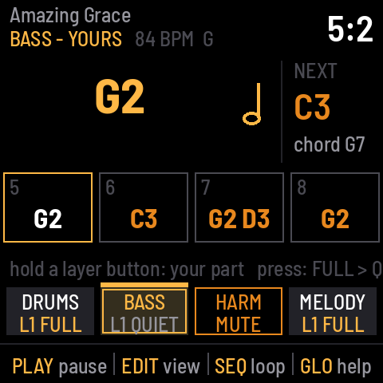

Built:  

### Part 3: views (harmony notation, two drum views, hiding views)

| your part | views (EDIT) |
|---|---|
| harmony | chord, keyboard, chart, guitar, **notation** (new) |
| bass | bass note, keyboard, chart, bass tab, notation |
| melody | melody note, keyboard, chart, roll, notation |
| drums | **drum grid, drum notation** (only these two now, the user's note) |

- **Harmony notation:**
  - **Staves:** a grand staff, treble and bass with 9 px line spacing. Notes from C4 up go on the treble staff, the
    rest on the bass staff.
  - **Chords:** the harmony at its level, as played. Block chords are stacked on one stem per staff (up on the
    treble, down on the bass); broken chords and arpeggios come out as single notes in time.
  - **Accidentals:** where a note differs from the key signature, e.g. the natural F of G7 in G.
  - **Rest of the page:** chord names above and a now line. The same simplifications as D025 apply: nearest simple
    value, no ties or rests, flags and no beams.
- **Drum notation:** a percussion staff.
  - Kick in the bottom space, low tom, snare in the third space, high tom.
  - Hi-hat above the top line, ride on the top line, crash on a ledger line, the cymbals with x noteheads.
  - The hands' notes of one hit share a stem up; the kick has its own stem down. Values run to the next hit.
- **The drums' other screens are gone**: the main view with the hit names and the chart.
- **Settings → "Views (hide some)" → the Views screen:**
  - every part's views, SHOWN or HIDDEN. SELECT picks one, and ALGORITHM, PLAY or EDIT toggles it;
  - EDIT skips the hidden ones, and a part whose view is hidden opens its first shown one;
  - each layer keeps at least one view ("ONE VIEW MUST STAY");
  - saved with the settings.
  - The saved settings grew: an M3 copy is a different size, so the defaults are used once.
- The settings screen has 8 rows of 22 px.

Mock-ups (written right after the code this time: see LOG): 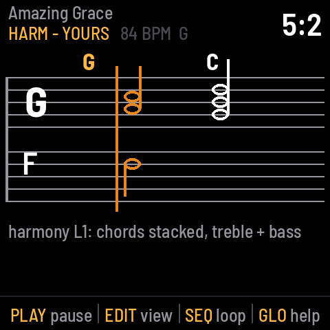
 

Built:  
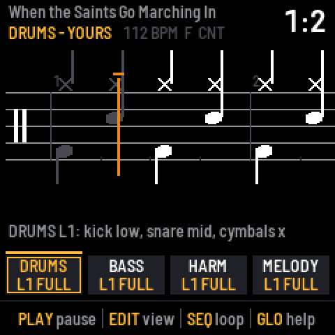 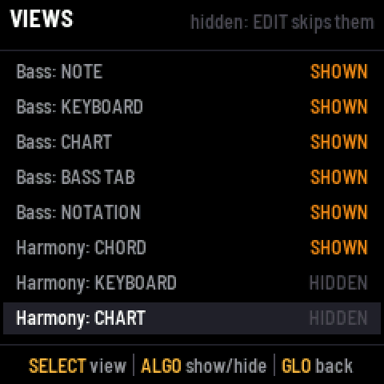

### Part 4: five harmony levels (format 1.3)

- **K1 to K4** go from 1 up to as many levels as the song has: now harmony 5, bass 4, drums 3 for all our songs. An
  older song keeps its 2 or 3.
- **Harmony ladder:** L1 block chords held → L2 block chords in the song's rhythm (waltz oom-pah-pah, shuffle,
  stride, ballad quarters, straight eighths) → L3 the same rhythm with inversions (voice leading) → L4 broken chords
  (Alberti in 4/4, low-mid-high in 3/4) → L5 arpeggios across about 1.5 octaves.
- **Bass:** L1 the root held → L2 the root in rhythm → L3 root and fifth → L4 walking (into the next root; the
  boogie line in the blues; root-fifth-octave in 3/4).
- **Drums:** L1 the pulse → L2 a groove → L3 the groove with fills every 4 bars and crashes at the sections.
- **Following the level:**
  - the rhythm cue follows the part's own notes at the level;
  - the inversion line names the level ("L3 inversions", "L5 arpeggio");
  - at **L4 and L5** the key lights and the keyboard view show **each note as it's played** (bright), with the
    chord around it at the middle level (darker in the keyboard view).

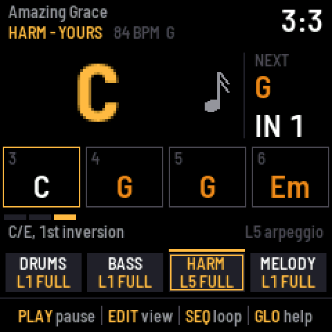 

## M5 (docs/plan-M5.md), part by part

### Part 1: fixes from the M4 test

- **Equal loudness across levels:**
  - every layer was measured alone at each level in every song;
  - the generated harmony L4/L5 and bass L1 get higher velocities, because they were about 0.7x the others;
  - imported songs' own parts are scaled to the loudness of the level they take, because they were up to 5x louder;
  - all levels of a layer are now within 1.6x of each other (docs/LOG M5 Part 1 has the numbers).
- **Let It Be L3** is the file's piano alone. The organ, merged in before, held every chord, so it sounded like L1.
- **Harmony L4/L5 lights:** every note the arpeggio or broken chord plays in the chord now shows on the keys:
  bright for the note played, the middle level for the rest.
- **Bass in its real octave:**
  - the generated bass roots are now E1–D#2 (they were an octave up), so the tab sits on the E and A strings;
  - setting **"Bass sound: REAL / +1 OCTAVE"** (default +1 OCTAVE, for the small speaker; REAL on headphones);
  - the tab shows the real notes; the bass-clef notation is written an octave up, as bass guitar music is.
- **Bass tab fingering:** a hand covers 4 frets. A note inside the position is played there, on the nearest string,
  and a shift costs by its length, so 2 on E then 2 on A, not 2 then 7 on E. The tab labels were right (G at the
  top); with the bass an octave down, the notes now sit where a player expects.
- **Top line:** the bar:beat / STOP / PAUSE label comes first, and the second line ends before it (no overlap).
- **Track boxes:** "L1" and "FULL" apart, in two colours.
- **A song opens fresh every time:** its first view, its key, its tempo.
- **Splash:** 4 s, with a start-up melody of our own: C5 E5 G5 B5, then a held E6, on electric piano with a little
  reverb, softer than a song.
- **Controls hint:**
  - before a song's play screen: "PRESS: its volume / HOLD: make it YOUR PART"; any button closes it;
  - shown 10 times, then off by itself. Setting **"Controls hint"** turns it on again;
  - the stopped legend alternates with "FX-LFO press volume | hold your part".
- **Settings:** 10 rows now, scrolling 8 at a time. M4's saved settings are kept: the record grew at its end.

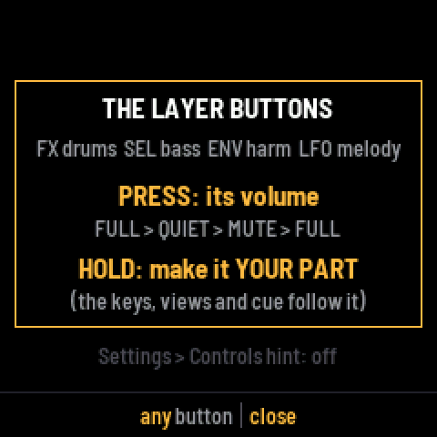 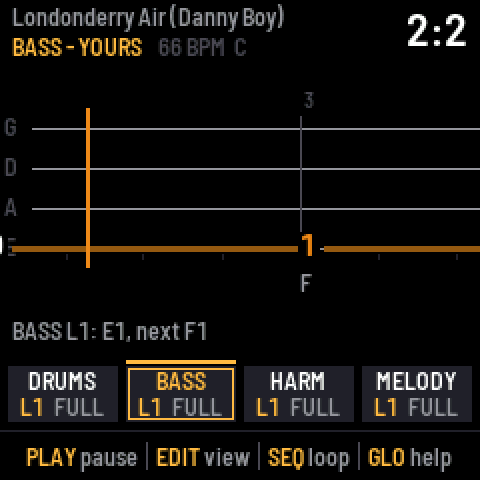
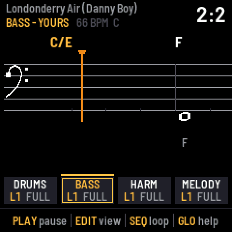 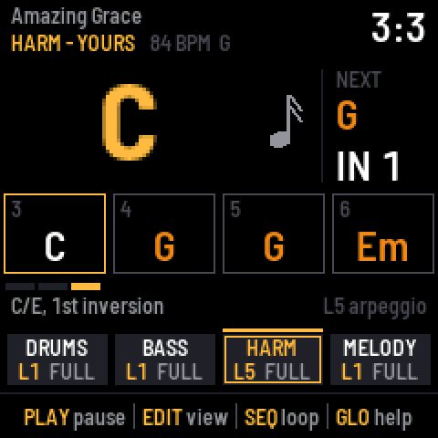

### Part 2: storage (no new controls)

- A song opens at level 1 of each layer as before; turning a level knob builds that level on the FM-1 (format 2.0):
  the layer changes at once, the others play on.
- While a song arrives over USB the FM-1 may show **MAKING ROOM** for a moment (it compacts its store).

### Part 3: the mode screen and SYNTH mode (trimmed, HANDOFF 2026-11-06 17:15)

- **Every power-on, after the splash:** the mascot and two boxes, **LEARN** / **SYNTH**, the cursor on LEARN.
  SELECT moves it; PLAY (or EDIT) chooses. LEARN is the play-along app as before. The mode stays until the FM-1 is
  switched off. The power-on rescue (REC, or OCT- + OCT+ held at power-on) comes before it, as before.
- **SYNTH** (8 voices, Felucca-Engines' ANALOG engine with our own host, chorus, delay, arpeggiator, 21 presets):

| Control | Does |
|---|---|
| keys | play (fixed velocity); OCT- / OCT+ shift them by octaves |
| SELECT | the preset (21, ours: NEON PAD, MIDNIGHT STRINGS, OCTAVE BOUNCE, SUNSET LEAD, SYNC SCREAM, ...) |
| K1 / K2 / K3 / K4 | cutoff / resonance / attack / release |
| ALGORITHM / PRESET | chorus / delay (a dotted eighth at the tempo, ping-pong) |
| ARP (press, release) | the arpeggiator on / off (its last pattern; UP at first) |
| ARP held + SELECT | the tempo, 60–200 BPM (the arpeggio and the delay follow it) |
| SEQ | the pattern: UP, DOWN, UP-DOWN |
| GLO | the rate: 1/4, 1/8, 1/16 |
| MASTER | the volume |

  Some presets bring their own arpeggio (OCTAVE BOUNCE up-down 1/16, CHIP BLIP and LASER ARP up, GRID PULSE down).
  A song sent over USB while in SYNTH mode is refused: switch off, choose LEARN, send. Later (not in this build):
  the PHASE engine, reverb, a random pattern, latch.

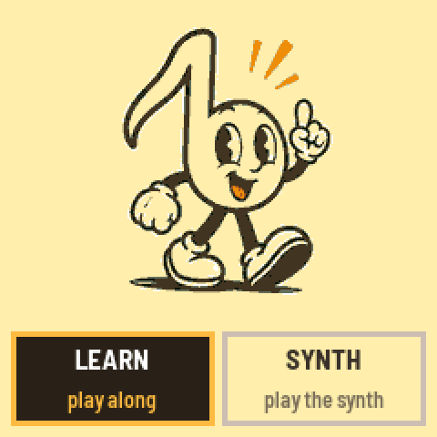 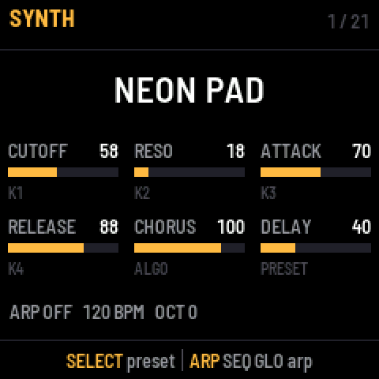
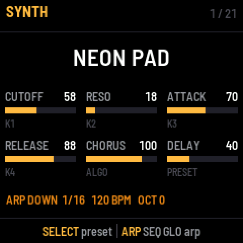 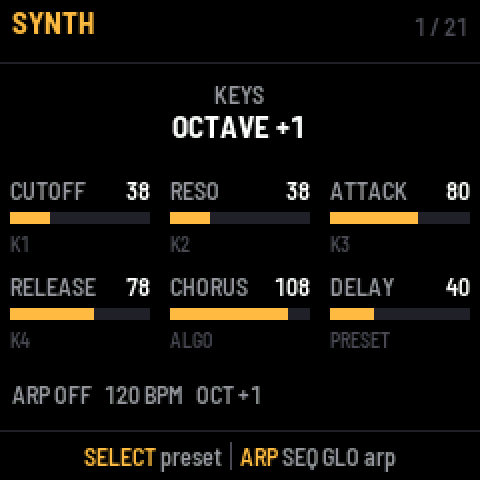

### M5.1: WIPE SONG STORE (a recovery action)

- **Settings > Wipe song store** (the last row, 11 rows now), or **GLO + HOME held at power-on** (before anything
  reads the song store; REC and OCT− + OCT+ stay fm1-base's): the question "WIPE SONG STORE?". A new PLAY press
  held 2 s erases every song on the FM-1 (a countdown shows); HOME, or any other button, keeps them. Settings and the
  firmware stay. Then "SONG STORE WIPED" and how to send the songs again; any button goes back.
- From the laptop: `tools/fm1song.sh wipe --yes` (the user runs it: it erases the song area).
- While a song is sent, the FM-1 may show **MAKING ROOM step n of about m** for a few seconds: it compacts its store
  between sends (no buttons meanwhile); the laptop waits and sends again by itself.

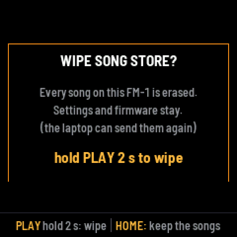 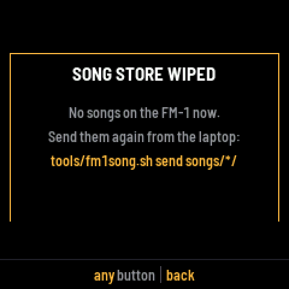


## M6 (docs/plan-M6.md), part by part

### Part 1: learning-mode fixes

- **Back to the mode screen:** hold **HOME 2 s** on any screen (learning or SYNTH), or **Settings > Switch mode**.
  A song playing stops; SYNTH goes quiet. The cursor then waits on the other mode. Not on the WIPE question, and a
  HOME held since power-on (GLO + HOME) never counts. The power-on rescues are unchanged.
- **QUIET** is readable: a dark amber box with light amber text (every box state's text at least 4.5:1).
- **Melody roll:** a vertical piano keyboard on the left, one key per pitch row; the notes sounding light their
  keys, each C is named.
- **Imported parts' loudness:** matched to the generated level every 4 bars (was once for the whole song). Resend the
  private songs to get it.

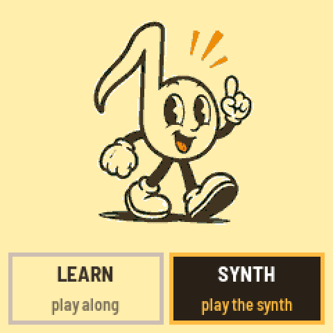 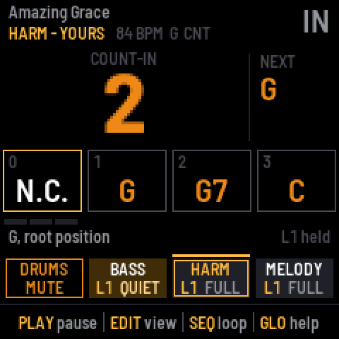
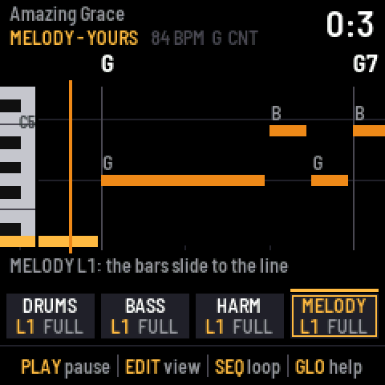

### Part 2: views

| Control / setting | Does |
|---|---|
| Settings > **Chord boxes, tab**: GUITAR / UKULELE | the harmony's chord boxes and the melody's tab for that instrument (default GUITAR) |
| EDIT (harmony) | ... CHORD, KEYBOARD, CHART, GUITAR (or UKULELE), NOTATION, **BAR VIEW** |
| EDIT (melody) | ... CHORD, KEYBOARD, CHART, MELODY ROLL, NOTATION, **GUITAR TAB** (or **UKULELE TAB**) |
| SELECT, in the scrolling and staff views (tabs, rolls, bar view, drum grid, notations) | **zoom**: about 0.8 to 6 bars on the screen (the notations up to twice their span) |
| **REC** | the TEMPO mode for 4 s: SELECT sets the tempo there (in the other views SELECT is the tempo, as before) |
| Settings > **Zoom at start** (was "Scrolling views show") | the zoom a song opens with: 1.5 or 3 bars |

- Ukulele: G C E A (the G string the high one), our own shapes, an open shape when there is one, else a movable one
  (the box shows its fret). A slash chord shows its chord's shape ("without /B").
- The chord boxes (guitar or ukulele) show the **rhythm icon** under the x / o lines, bright at each attack.
- The melody tab: playable positions as the bass tab (a hand over 4 frets, open strings when they fit).
- The bar view: the harmony's notes as bars sliding to the line, the piano keys on the left.

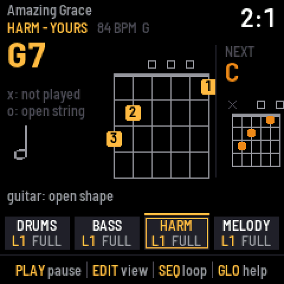 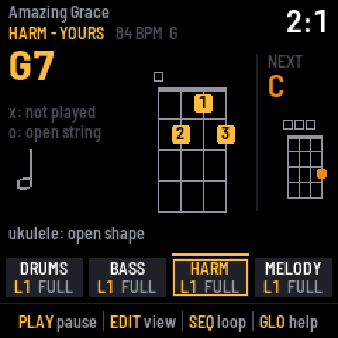 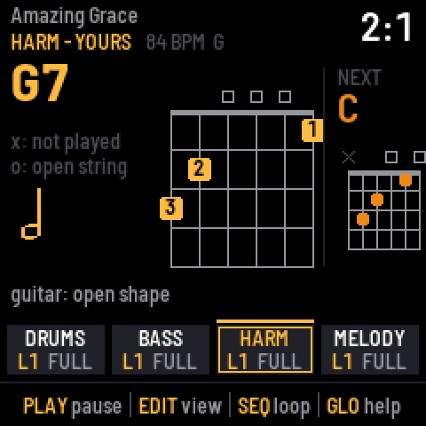
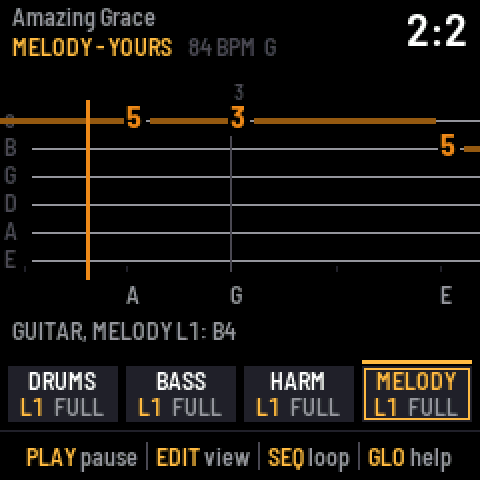 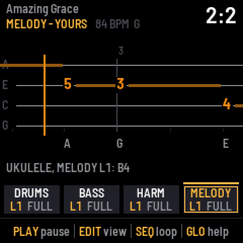
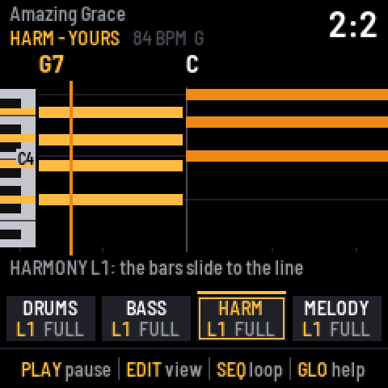 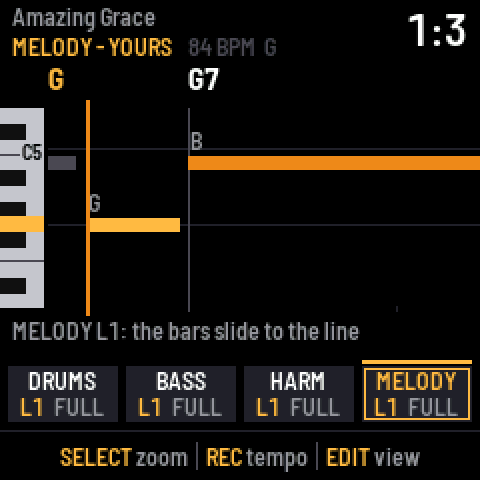 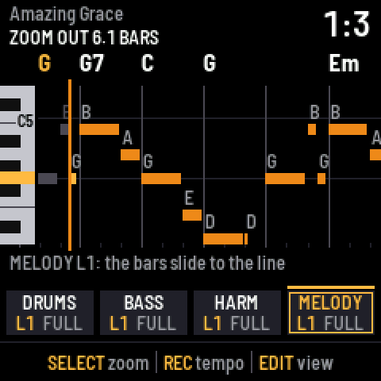

### Part 3: SYNTH, round 2

| Control | Does |
|---|---|
| **EDIT held (SHIFT)** + K1 / K2 / K3 / K4 | reverb / bit-crush / arp rate / detune (the screen shows this set while EDIT is held) |
| SEQ | the arp pattern: UP, DOWN, UP-DOWN, **RANDOM** |
| GLO | the arp rate: 1/4, 1/8, **1/8T**, 1/16 |
| **PLAY** | the drum jam on / off |
| **FX** | the jam's style: WALTZ, BALLAD, SHUFFLE, MARCH, POP, TRAIN (the learning engine's) |
| **SCL** | the jam's level: L1 pulse, L2 groove, L3 with fills (changes on the next beat while it plays) |
| ARP held + SELECT | the tempo, 60–200 BPM: the arpeggio, the delay and the drum jam follow it |
| HOME held 2 s | back to the mode screen |

  The drum jam loops 8 bars of the style's drums, generated on the FM-1 as for any song, under the synth. The
  reverb is ours (about 1.5 s); each preset brings its own reverb and crush amounts (CHIP BLIP crushed).

  

## M7 (docs/plan-M7.md), part by part

### Part 1: learning mode

- **NOT IMPLEMENTED** (D044): a button with no job on the screen shown opens a small pop-up; **any button closes it**
  (that press does nothing else, nor its release); it also closes itself after 2.5 s. Never for a button held since
  power-on; never on the splash, the mode screen, the hint or the WIPE question. HOME held 2 s works with it open;
  the keys keep playing; the encoders never open it (their turns are dropped while it is open).
- **A song's start level** (format 2.1): a song can open with a layer on another level than 1 (Zombie: bass L2).
- Rockin' in the Free World removed; Zombie's lead a little quieter.

The census (tools/m7_test.py m7p6 checks every screen x every button: its job, or the pop-up, never nothing):

| Screen | Free buttons (the pop-up) | Every other button's job |
|---|---|---|
| Song list | FX SCL ENV LFO SAVE ARP SEQ REC | PLAY / EDIT open, HOME the folders, GLO help, OCT- / OCT+ octave |
| Folder list | FX SCL ENV LFO SAVE ARP SEQ REC, **HOME** (a short press) | PLAY / EDIT open, GLO help, OCT +- |
| Play screen | the layer buttons of layers the song does not have (none for ours) | as M6 |
| Help | none (any button: back; GLO: settings) | |
| Settings, Views | FX SCL ENV LFO SAVE ARP SEQ REC | PLAY / EDIT change, GLO / HOME back, OCT +- |
| Mode screen (no pop-up, D044) | the others do nothing | PLAY / EDIT choose |
| SYNTH main, edit pages | LFO SCL SAVE REC (SAVE: M7.1) | see Part 2 |
| SYNTH pattern menu | FX SCL ENV LFO EDIT GLO SAVE REC | SEQ / PLAY choose, HOME back, ARP, OCT +- |
| SYNTH help | none (any button: back; GLO: settings) | |
| SYNTH settings | FX SCL ENV LFO SAVE ARP SEQ REC | PLAY / EDIT change, GLO / HOME back, OCT +- |

 

### Part 2: SYNTH, rebuilt on one parameter table (D039)

| Control | Does |
|---|---|
| **PRESET** | the preset, 1..30 |
| **SELECT** | the tempo, 60..200 BPM (the arpeggio, the delay, the drums follow it); quickly: 5 a click |
| **K1..K4** (main screen) | quick: cutoff, resonance, reverb mix, delay mix (the bottom row shows the value while turned) |
| **EDIT** | the next edit page; after the last, the main screen |
| **ALGO** | the pages forward / back (from the main screen: the first / the last) |
| **K1..K4** (an edit page) | that page's four settings (0..127 ones 2 a click; short lists one a 2 clicks) |
| **ENV** / **FX** | the ENVELOPE page / the first FX page (again: the main screen / the next FX page) |
| **HOME** (a tap) | the main screen (on it: a hint "hold 2 s") |
| HOME held 2 s | the mode screen (as M6) |
| **SEQ** | the drum pattern menu: SELECT scrolls, SEQ chooses, PLAY chooses and plays, HOME back |
| **PLAY** | the drums on / off |
| **GLO** | SYNTH's controls; GLO again: SYNTH's settings (drum volume 0..10, drum kit), saved |
| **ARP** | the arpeggiator on / off (pattern, rate, octaves, gate: the ARP page) |
| LFO, SCL, SAVE, REC | NOT IMPLEMENTED (SAVE: user presets, M7.1) |
| OCT- / OCT+ | the keys' octave |

The pages, in order: ENVELOPE (attack, decay, sustain, release) - FILTER (cutoff, resonance, env amount, type
LP / BP / HP) - SOUND A, SOUND B (the engine's own: ANALOG WAVE DTN MIX NOIS | DRV KTR LFO RATE PWM DEPTH; PHASE
WAVE WAVE2 DCW ENV | DTN LINE SUB FOLD) - ARP (pattern UP / DOWN / UP-DOWN / RANDOM, rate 1/4 1/8 1/8T 1/16, octaves
1-3, gate) - FX 1 (chorus depth, chorus mix, tremolo rate, tremolo depth) - FX 2 (phaser rate, depth, mix, crush) -
FX 3 (delay time 1/16 .. 1/2, feedback, delay mix, fuzz) - FX 4 (reverb size, damping, reverb mix, LEVEL). Each page:
its title, its number ("3/9"), four values in the K1..K4 places (2 x 2), the drum line, the instruction row. The
EDIT-held SHIFT layer of M6 is gone. A preset is a 64-byte record (vsynth.h); the sound plays from a RAM copy, so
turning a knob changes the sound, not the stock preset (M7.1 will save it).

  
 
  
  
  
 

### Part 3: effects

Fixed chain: voices -> fuzz -> bit-crush -> tremolo -> phaser -> chorus -> delay -> reverb -> LEVEL. New: **tremolo**
(0.1..12 Hz), **phaser** (6 all-passes), **fuzz** (drive into a soft curve, a tone filter; its loudness follows the dry
sound, so FUZZ changes the colour, not the volume). All ours. An effect at 0 costs nothing (skipped).

### Part 4: drums (D041)

PLAY starts the pattern from its bar's start; a pattern chosen while it plays starts on the next bar. Three kits
(SYNTH settings): **ACOUSTIC** (the GM drum kit), **808** (our sine kick and toms, noise snare / hats / clap),
**CHIP** (the LOFI chip voice). The drums have their own 6 voices (never the synth's 8) and their own volume (SYNTH
settings), not the preset's effects. ROCK1 at every SYNTH start. The patterns (docs/drum-patterns.txt, x accent,
o normal, g ghost; the user listens and prunes):

**ROCK1** (4 beats, 16 steps a bar, 1 bar)

```text
KICK  x.......x.o.....
SNARE ....x.......x...
CHH   x.o.x.o.x.o.x.o.
```

**ROCK2** (4 beats, 16 steps a bar, 2 bars)

```text
KICK  x......ox.x.....|x......ox.x...o.
SNARE ....x.......x...|....x.......x..g
CHH   x.o.x.o.x.o.x.o.|x.o.x.o.x.o.x.o.
```

**ROCK3** (4 beats, 16 steps a bar, 2 bars)

```text
KICK  x.x.....x.x.....|x.x.....x.x.....
SNARE ....x.......x...|....x.......x.xx
OHH   x.o.x.o.x.o.x.o.|x.o.x.o.x.o.....
TOMLO ................|.............o..
TOMHI ................|............o...
```

**POP1** (4 beats, 16 steps a bar, 1 bar)

```text
KICK  x.......x.......
SNARE ....x.......x...
CHH   o.o.o.o.o.o.o.o.
```

**POP2** (4 beats, 16 steps a bar, 1 bar)

```text
KICK  x.....o.x.......
CHH   oooooooooooooooo
CLAP  ....x.......x...
```

**POP3** (4 beats, 16 steps a bar, 2 bars)

```text
KICK  x.....o...o.....|x.....o...o..o..
SNARE ....x.......x...|....x.......x...
CHH   o.o.o.o.o.o.o.o.|o.o.o.o.o.o.o.o.
OHH   ................|..............o.
CLAP  ....o.......o...|....o.......o...
```

**FUNK1** (4 beats, 16 steps a bar, 1 bar)

```text
KICK  x.x.......x..o..
SNARE ....x..g.g..x..g
CHH   xoxoxoxoxoxoxoxo
```

**FUNK2** (4 beats, 16 steps a bar, 2 bars)

```text
KICK  x..x..x...x.....|x..x......xx....
SNARE ....x..g.g.gx...|.g..x..g.g..x.g.
CHH   x.ox.ox.x.ox.ox.|x.ox.ox.x.ox.o..
OHH   ................|..............o.
```

**DISCO** (4 beats, 16 steps a bar, 1 bar)

```text
KICK  x...x...x...x...
SNARE ....x.......x...
CHH   x...x...x...x...
OHH   ..o...o...o...o.
```

**HOUSE** (4 beats, 16 steps a bar, 1 bar)

```text
KICK  x...x...x...x...
CHH   ..o...o...o...o.
OHH   ..x...x...x...x.
CLAP  ....x.......x...
```

**TECHNO** (4 beats, 16 steps a bar, 1 bar)

```text
KICK  x...x...x...x...
CHH   ooxoooxoooxoooxo
OHH   ..o...o...o...o.
RIM   ..........o.....
```

**SYNTHWAVE1** (4 beats, 16 steps a bar, 1 bar)

```text
KICK  x...x...x...x...
SNARE ....x.......x...
CHH   o.o.o.o.o.o.o.o.
CLAP  ....o.......o...
```

**SYNTHWAVE2** (4 beats, 16 steps a bar, 2 bars)

```text
KICK  x.....x.x.......|x.....x.x...o...
SNARE ....x.......x...|....x.......x...
CHH   o.oxo.oxo.oxo.ox|o.oxo.oxo.oxo.o.
OHH   ................|..............x.
TOMLO ................|...........o....
```

**HIPHOP1** (4 beats, 16 steps a bar, 1 bar)

```text
KICK  x......x..x.....
SNARE ....x.......x...
CHH   o.o.o.o.o.o.o.o.
```

**HIPHOP2** (4 beats, 16 steps a bar, 2 bars)

```text
KICK  x..o......x.....|x..o..o...x.....
SNARE ....x.......x..g|....x...g...x...
CHH   x.o.x.oox.o.x.oo|x.o.x.oox.o.x.o.
OHH   ................|..............o.
```

**REGGAE** (4 beats, 16 steps a bar, 1 bar)

```text
KICK  ........x.......
SNARE ........x.......
CHH   ..o...o...o...o.
RIM   ........x.......
```

**SALSA** (4 beats, 16 steps a bar, 2 bars)

```text
KICK  ...o.......o....|...o.......o....
CHH   x.o.x.o.x.o.x.o.|x.o.x.o.x.o.x.o.
TOMLO .......x.......x|.......x.......x
TOMHI ......o.......o.|......o.......o.
RIM   x..x..x...x.x...|..x.x...x..x..x.
```

**BOSSA** (4 beats, 16 steps a bar, 2 bars)

```text
KICK  x..ox..ox..ox..o|x..ox..ox..ox..o
CHH   o.o.o.o.o.o.o.o.|o.o.o.o.o.o.o.o.
RIM   x..x..x...x..x..|..x..x..x..x....
```

**SHUFFLE** (4 beats, 12 steps a bar, 1 bar)

```text
KICK  x.....x.....
SNARE ...x.....x..
CHH   x.ox.ox.ox.o
```

**BLUES** (4 beats, 12 steps a bar, 2 bars)

```text
KICK  x.....x.....|x.....x.o...
SNARE ...x.....x..|...x.....x.o
CHH   x.ox.ox.ox.o|x.ox.ox.ox.o
```

**WALTZ** (3 beats, 12 steps a bar, 1 bar)

```text
KICK  x...........
SNARE ....o...o...
CHH   ....o...o...
```

**BALLAD** (4 beats, 16 steps a bar, 2 bars)

```text
KICK  x.......o.o.....|x.......o.....o.
SNARE ................|............x.g.
CHH   o.o.o.o.o.o.o.o.|o.o.o.o.o.o.o.o.
RIM   ....x.......x...|....x...........
```

**6/8** (2 beats, 12 steps a bar, 1 bar)

```text
KICK  x...........
SNARE ......x.....
CHH   x.o.o.x.o.o.
```

**TRAIN** (4 beats, 16 steps a bar, 1 bar)

```text
KICK  x.......x.......
SNARE gogxgogxgogxgogx
CHH   ..o...o...o...o.
```

**MARCH** (4 beats, 16 steps a bar, 2 bars)

```text
KICK  x.......x.......|x.......x.......
SNARE x...x...x.gox...|x...x...xgxgx.x.
OHH   ................|x...............
```


### Part 5: the 30 presets (D042)

1 NEON PAD, 2 DUSK STRINGS, 3 OCT BOUNCE (arp), 4 SUNSET LEAD, 5 SYNC SCREAM, 6 CHROME BRASS, 7 GLASS PLUCK,
8 VAPOR KEYS, 9 RISER, 10 CHIP BLIP (arp), 11 DRIVE BASS, 12 HAZE PAD, 13 LASER ARP (arp), 14 NIGHT DRIVE,
15 SAW STRINGS, 16 HORIZON PWM, 17 TAPE CHOIR, 18 STAB 84, 19 GRID PULSE (arp), 20 E-PIANO (PHASE), 21 E-GUITAR,
22 E-SITAR (PHASE), 23 POTATO, 24 PARKER, 25 EDS (arp), 26 OUTRUN BASS, 27 MIAMI PAD (PHASE), 28 CHROME ARP (PHASE,
arp), 29 NEON BELLS (PHASE), 30 VHS STRINGS. All ANALOG unless marked. Level-matched by LEVEL (FX 4: 100 as made,
half a dB a step).

## M8 (docs/plan-M8.md), part by part

### Part 1: renames (D050)

- **The mode screen**: three choices under the mascot, in this order: **SONG LEARN** ("play along a song"; M9: "Play with a song"),
  **BACKTRACK** (jam over a band), **SYNTH**. The cursor is on SONG LEARN at every power-on and whenever the screen
  opens again (HOME held 2 s from any mode, or Settings > Switch mode). SELECT moves it (it stops at the ends), PLAY or
  EDIT chooses.
- **The splash**: "Tuneka - Song Sidekick" (M8 named it; M10 renamed it), under it only the milestone, "m10" (the version, stays in the
  help and `--info`). fm1-base's crash and safe-mode screens and the screen reader use the same name. The USB / MIDI
  names, the identity (FM-1_4600xxxx) and the package name are unchanged.
- **Presets**: E-PIANO, E-GUITAR, E-SITAR are presets 1-3; SYNTH starts on preset 1 (E-PIANO). The rest in M7's order:
  4 NEON PAD, 5 DUSK STRINGS, 6 OCT BOUNCE, 7 SUNSET LEAD, 8 SYNC SCREAM, 9 CHROME BRASS, 10 GLASS PLUCK,
  11 VAPOR KEYS, 12 RISER, 13 CHIP BLIP, 14 DRIVE BASS, 15 HAZE PAD, 16 LASER ARP, 17 NIGHT DRIVE, 18 SAW STRINGS,
  19 HORIZON PWM, 20 TAPE CHOIR, 21 STAB 84, 22 GRID PULSE, 23 POTATO, 24 PARKER, 25 EDS, 26 OUTRUN BASS,
  27 MIAMI PAD, 28 CHROME ARP, 29 NEON BELLS, 30 VHS STRINGS.
- **Song titles**: twelve-bar-blues is "12-Bar Blues", four-chords "Four Chord Tune" (slugs unchanged; resend both).

 

### Part 2: format 2.2, energy, five new styles (D047, D048)

No new controls. docs/song-format.md 2.7. A section's **energy** (0..2) adds to every generated layer's level in its
bars (the chorus of a backtrack: +1). Five new styles for the generators (and song.yaml): ROCK, INDIE POP, BOSSA NOVA,
FUNK, REGGAE (harmony L2/L3 rhythm, bass L4 line, drums L2 groove from M7's ROCK1, POP3, BOSSA, FUNK1, REGGAE).

### Part 3: the 30 backtracks (D046)

songs/backtracks/ (tools/backtracks.py from tools/backtracks.tsv), C major or A minor, a full form: INTRO, VERSE 1
(x2), CHORUS 1 (x2, +1), VERSE 2, CHORUS 2 (+1), BRIDGE, CHORUS 3 (+1), ENDING; blues: INTRO, 3 rounds (0, +1, +1),
ENDING. Sent like songs (in SONG LEARN); SONG LEARN never lists them.

### Part 4: BACKTRACK (D046, D048)

**SETUP** (instead of a song list):

| Control | Does |
|---|---|
| K1 | the progression (1-30: its number and name; its numerals under it) |
| K2 | the style: POP, ROCK, INDIE POP, BALLAD, SHUFFLE, STRIDE, WALTZ (3/4), COUNTRY, BOSSA NOVA, FUNK, REGGAE |
| K3 | the structure: LOOP (the first verse, looped), VERSE/CHORUS (the first verse and chorus, looped), FULL (intro to ending) |
| K4 | the key (12; major or minor by the progression); the progression's chords in it under it |
| SELECT | the tempo (each style's own until turned: POP 100, ROCK 120, INDIE POP 110, BALLAD 70, SHUFFLE 96, STRIDE 110, WALTZ 96, COUNTRY 140, BOSSA NOVA 130, FUNK 100, REGGAE 80) |
| PLAY | starts (the count-in as set) |
| GLO | help (GLO again: the settings) |
| HOME held 2 s | the mode screen |
| keys | the melody sound |

At entry: 1 POP 1, POP, LOOP, C, 100 BPM. The choices are kept until power-off.

  

**PLAY screen**: SONG LEARN's play screen and controls (the same legend): PLAY play / pause, HOME stop then SETUP, the
layer buttons (a press: FULL / QUIET / MUTED; held: your part), EDIT the views, SAVE the KEY mode, SELECT the tempo,
SEQ the loop (A, B, off), ARP the count-in, OCT- / OCT+, GLO help. **K1-K3**: the drums', bass's, harmony's level
("busier / simpler"; the energy adds on top in a chorus); **K4**: the melody sound (shown for a moment). **LFO** (no
melody layer: the melody is yours): held, the melody's views again. Every view of drums, bass and harmony works as in
SONG LEARN.

  
 

### Part 5: what can I play now (D049)

- Nothing (or the melody) your part: **SCALE KEYBOARD** (the FM-1's 27 keys, F3-G5) and **SCALE FRETBOARD** (guitar,
  or ukulele by the "Chord boxes, tab" setting; frets 0-12); EDIT between them. The key and scale on top, the chord now
  (big) and the next.
- Marking: the scale's notes (dark amber), the current chord's tones (bright, changing at each chord), the next
  chord's tones (a ring) in the chord's last beat.
- The FM-1's key lights: the chord's tones bright, the scale's other notes at the middle level, the next chord's dim
  in the last beat (Settings > Key lights OFF: none).
- Settings > **Scale guide**: PENTATONIC (default: major pentatonic for a major progression, minor pentatonic for a
  minor one, the blues scale for 20-22) / FULL SCALE (major, natural minor; a major-key blues: mixolydian) / CHORD
  TONES (only the chord).

 
  

### Part 6: the melody sound (D049)

The 30 SYNTH presets (as made, arpeggio off) on 4 voices, mixed over the band; the delay's longest time is halved in
BACKTRACK (0.37 s; a longer note value is halved until it fits). K4 on the play screen chooses; kept until power-off.

 

The census (D044, tools/m8_test.py m8census):

| Screen | Free buttons (the pop-up) | Every other button's job |
|---|---|---|
| BACKTRACK SETUP | FX SCL ENV LFO EDIT SAVE ARP SEQ REC, **HOME** (a short press) | PLAY start, GLO help, OCT +- |
| BACKTRACK play screen | none | as SONG LEARN's; LFO: the melody yours (held) |
| Mode screen (no pop-up, D044) | the others do nothing | PLAY / EDIT choose |

## M9 (docs/plan-M9.md), part by part

Version 0.9.0-m9 (FM-1_46000900), the splash's second line "m9". Screenshots: docs/step-M9/ (the emulator, the final package).

### Part 1: the count-in
A count-in happens only right after **PLAY from stopped** or **PLAY to go on from a pause**, with the count-in on (ARP lit).
Once the music has started the player never counts in again, whatever the loop does: a loop that jumps back to before the
resume point (a pause, a later start point) no longer clicks. Count-in off never clicks.

### Part 2: small fixes
- **SONG LEARN's folders**: "All songs" and every category count songs only, never the backtracks; a store with only
  backtracks behaves as an empty store.
- **The mode screen**: a small title line "modes:" above the three choices, and SONG LEARN's subtitle is "Play with a song".
- **BACKTRACK's play screen**: the LFO light is on steadily (the melody has no layer; holding LFO makes it your part).


### Part 3: the band's tiers (D052)
A backtrack's drums, bass and harmony each have **4 tiers** of their style (tools/band_styles.txt: the user edits it by ear),
so the style sets the rhythm of all three layers together at every complexity. Complexity **C** (1 SIMPLE, 2 MEDIUM, 3 BUSY)
plays tier C in intros, verses and bridges and **tier C + 1 in choruses** (so tier 4 is heard in choruses at BUSY). Tiers 2-4
put a crash with the kick on a section's first bar (not an intro); tiers 3-4 a snare fill in the last bar of a section that is
followed by another (tier 4 adds a tom); the last bar holds the chord and the root with a kick and a crash at every tier.

### Part 4: one knob map (D053)
The same on **SETUP** and on the **play screen**; on SETUP they are the choices (kept until power-off), on the play screen they
take effect at the next boundary:

| Control | Does | On the play screen, takes effect |
|---|---|---|
| K1 | progression (1-36) | at the next phrase boundary |
| K2 | style (11) | at the next phrase boundary |
| K3 | complexity: 1 SIMPLE, 2 MEDIUM, 3 BUSY (default 2) | at the next bar line |
| K4 | melody sound (the 30 presets) | at once |
| PRESETS | key, a semitone a click, all 12 (the nearest way) | at the next bar line |
| ALGO | structure: LOOP, VERSE/CHORUS, FULL | at the next phrase boundary |
| SELECT | tempo | at once |

- **Phrase boundary**: the next bar line where the bar in its section is a multiple of 4, or the loop's wrap, whichever comes first.
  While a change waits, the top line says **NEXT: <what>** (e.g. NEXT: REGGAE, 15 MINOR POP, FULL); turning the knob again
  updates the waiting value; turning it back to what plays cancels it; changes due at the same line are made together.
- **The switch is seamless**: the next version is built while the band plays and the music goes on at the bar line, in the same
  place of the form (the same section and bar of the new file, else the start of the structure's loop, or the first verse in
  FULL); there is no count-in. Changing a style to or from WALTZ changes the metre (3/4). Stopped or paused, a change is made at
  once (the band is loaded again; PLAY starts from the loop's start or the start).
- **Structure**: playing on inside the new loop, else the new loop's start at the boundary; FULL removes the loop and ends at the
  ending.
- **SETUP rows**: K1 PROGRESSION (number, name, a **MAJOR** or **MINOR** badge, the numerals), K2 STYLE, K3 COMPLEXITY, K4
  SOUND, PRESETS KEY ("C major" / "A minor", the chords in it), ALGO STRUCTURE, SELECT TEMPO.
- **Play screen top line**: the progression's number and name with its badge, then the style, structure and C1 / C2 / C3;
  the layers row shows each layer's tier now playing (L1-L4: a chorus shows one more) and FULL / QUIET / MUTED.
- **Removed from BACKTRACK**: the per-layer level knobs (K1-K3), SONG LEARN's start point and loops (PRESETS by section, ALGO by
  bar, SEQ), and SAVE's KEY mode (PRESETS does the key): **SEQ and SAVE give the "not implemented" pop-up** on the play screen.
  Kept: PLAY play / pause, HOME stop then SETUP, the layer buttons (press: FULL / QUIET / MUTED; hold: your part), EDIT views, ARP
  count-in, OCT-/OCT+, GLO help, LFO held: the melody yours.

 
 
 


### Part 5: progressions (D054)
Renamed: 6 FIESTA (was LA BAMBA), 13 HEROIC (MARIO), 14 BITTERSWEET (CREEP). New minor progressions: 31 MINOR FOLK
(i iv v i | bVI bVII i i), 32 EPIC (i bIII bVII iv), 33 AEOLIAN (i bVI bVII i), 34 HARMONIC (i bVI iv V), 35 MINOR 2-5-1
(ii7b5 V7 i i), 36 MINOR FUNK (i7 i7 iv7 iv7). A progression is major or minor by design (no switch): the badge says which.

### The census (D044, tools/m9_test.py m9census)

| Screen | Free buttons (the pop-up) | Every other button's job |
|---|---|---|
| BACKTRACK SETUP | FX SCL ENV LFO EDIT SAVE ARP SEQ REC, **HOME** (a short press) | PLAY start, GLO help, OCT +- |
| BACKTRACK play screen | **SEQ, SAVE** | as SONG LEARN's, FX SCL ENV LFO volume / your part, EDIT views, ARP count-in, REC tempo mode, HOME stop; LFO: the melody yours (held) |
| Mode screen (no pop-up, D044) | the others do nothing | PLAY / EDIT choose |
| SONG LEARN, SYNTH | unchanged (M7, M8) | |

## M10 (docs/plan-M10.md), part by part

Version 0.10.0-m10 (FM-1_46001000; the early build 0.10.1-m10a, FM-1_46001001), the splash's second line "m10". Screenshots:
docs/step-M10/ (the emulator, the final package; the file names below).

### Part 1: two fixes from the M9 review

- **A section's crash no longer forces a kick.** At the first bar of every section but the INTRO, tiers 2-4 add the crash only; the
  kick is whatever the tier's pattern has (REGGAE's one-drop keeps its empty beat 1).
- **A change made while PAUSED keeps the pause**: the new band is built (the 300 ms rule) and the player stays paused at the same
  section and bar; PLAY then goes on from there (a count-in first, if it is on). While STOPPED a change is made at once and PLAY
  starts from the loop's start, as in M9.

### Part 2: BACKTRACK's screens (D057; SONG LEARN unchanged)

- **The value pop-up** (`m10p2-setup-K1.png` "15 MINOR POP" with its badge, `m10p2-setup-K3.png` "BUSY", `m10-p2-play-K2.png` on the
  play screen): turning K1 (**Progression**), K2 (**Style**), K3 (**Song Complexity**), K4 (**Melody Sound**), PRESETS (**Key**, "C
  major" / "A minor"), ALGO (**Structure**) or SELECT (**Tempo**, "105 BPM") opens a pop-up with the title and the value in big
  letters, over the screen (the music and the key lights go on; the screen under it is drawn again when it closes). On the play
  screen a change that waits adds "at the next phrase" or "at the next bar". It closes by itself 1.5 s after the last turn;
  any button press closes it AND does its job (unlike the "not implemented" pop-up); HOME held 2 s always works.
- **SIMPLE / MEDIUM / BUSY** on SETUP, in the pop-up, in the NEXT line and on the top line (no "C1".."C3" anywhere).
- **The NEXT line says what waits** (`m10-p2-play-two.png`): `NEXT: PROG 7`, `NEXT: STYLE REGGAE`, `NEXT: STRUCTURE FULL`, `NEXT: KEY D`,
  `NEXT: COMPLEXITY BUSY`; several: the first (in that order) and `+n`. A value that does not fit is shortened, never the word.
- SETUP's K4 row is **MELODY SOUND**.
- **The section indicator** (play screen, top line, right end): INTRO, VERSE, CHORUS, BRIDGE or ENDING. In the last bar before a
  different section starts it shows the NEXT section's name and **blinks** (250 ms on, 250 ms off) until that section starts (`m10-p2-blink-12.png`
  caught in a pause, `m10-p2-steady-12.png` after it). In LOOP it never blinks; in VERSE/CHORUS it blinks at the loop's wrap. The MAJOR /
  MINOR badge moved to SETUP and the pop-up only.

### Part 3: Tuneka - Song Sidekick (D058, D063)

The product name is now **Tuneka**: "Tuneka - Song Sidekick" on the splash (`m10p3-splash.png`, with `m10` under it), in the help and in fm1-base's
crash and safe-mode screens. The mode screen has the name as a title across the top and the mascot a little smaller (`m10p3-mode.png`);
the cursor starts on SONG LEARN. The USB and MIDI names are unchanged.

### Part 4: 42 progressions (D060)

37 PHRYGIAN (i bII), 38 LINE CLICHE (i imaj7 i7 i6), 39 MINOR CADENCE (i iv V i), 40 DESCENT (IVmaj7 iii7 ii7 Imaj7), 41 LYDIAN (I II), 42
JAZZ BLUES (a 12-bar jazz blues; suggested style SHUFFLE). K1 goes to 42 and wraps. The chord names on SETUP show Ammaj7 / Am6 etc.;
42's numerals line shows its first eleven chords (a 39-character field; the music has all twelve). `m10p4-reach.png`, `m10p4-42-SHUFFLE.png`.

### Part 5: the song info line (D062)

A song's Settings screen (GLO twice from its play screen) ends with its info line in small dim type (`m10p5-info.png`): "Traditional
spiritual, c. 1896". Private and imported songs have none; nothing when no song is loaded; nowhere else. Stored in an optional INFO chunk
(docs/song-format.md 2.8).

### Part 6: band kits (D062)

On SETUP only, **SEQ** steps the kit: **STUDIO** (M9's sound), **ACOUSTIC** (GM kit, acoustic bass, nylon guitar), **ELECTRO** (the 808 drums,
Synth Bass 1, Pad 2) and **CHIP** (the CHIP drums, Synth Bass 1, Electric Piano 1); the pop-up is titled "Band Kit" and the KIT row is under TEMPO
(`m10p6-seq2.png`). The notes are the same in every kit; only the sound changes. Reset at power-off like the other choices. On the play screen SEQ
stays "not implemented". The worst-case CPU (FULL, BUSY chorus, MIAMI PAD x 4, a live switch): STUDIO 44 %, ACOUSTIC 41 %, ELECTRO 57 %,
CHIP 47 % of a block (limit 60 %).

### Part 7: saving user presets (D040, D062)

In SYNTH, **SAVE** opens **SAVE TO Unn** (`m10p7-open.png`): **SELECT** chooses the slot (U01..U30, each with its name or EMPTY), the name starts
as the current preset's, **K1** moves its cursor, **K2** changes the character (A-Z, 0-9, space, -) (`m10p7-edit.png`); **SAVE** again saves. A
taken slot asks "REPLACE U05 <name>?  SAVE = yes  HOME = no" (`m10p7-ask.png`); **HOME** cancels at any point with nothing written. After the
write "SAVED U05" shows for 1.5 s (`m10p7-save.png`) and the sound goes on as the saved preset, now selected as U05. The stock presets 1-30
can never be written. **PRESETS** goes through the 30 stock presets and then the saved ones ("U05 <name>"); BACKTRACK's K4 uses the same list.
There is no delete (overwrite only). The presets live in their own flash object (0xDE000-0xDFFFF), torn-write safe; the song store, WIPE SONG
STORE, sends and deletes never touch it, and it never touches them.

### The census (tools/m9_test.py m9census, M10)

SETUP: PLAY, GLO, OCT-/OCT+ and now **SEQ** (the band kit) have jobs; every other button shows the "not implemented" pop-up. The play screen as in M9.
SYNTH: SAVE has a job (it was "not yet").

## M10.1 (0.10.2-m10.1: the user's notes on M10; docs/plan-M10.1.md; decisions docs/decisions-M10.1.md)

Version 0.10.2-m10.1 (identity FM-1_46001002), the splash's second line "m10.1". Screenshots: docs/step-M10.1/ (the emulator; the file names below).

### Part 1: screens and text

- **The name** is "KickSide - Your Musical SideKick" on the splash (`m101p1-splash.png`), across the top of the mode screen (`m101p1-mode.png`), in the help and in
  fm1-base's crash and safe-mode screens; one line in the larger type (the screen reader says "KickSide, your musical sidekick"). The mode order is unchanged:
  SONG LEARN, BACKTRACK, SYNTH.
- **SYNTH's edit pages name the preset**: "ENVELOPE - E-PIANO", "FX 2 - POTATO", "ENVELOPE - U05 ZUNJET" (`m101p1-t-env.png`); a title that does not fit
  beside the page number ("3/9") is drawn in the next smaller type, never cut (`m101p1-t-user.png`: the longest name, 12 characters).
- **The bottom instruction row** keeps each of its pages **6 s** (it was 3 s) in SONG LEARN, BACKTRACK and SYNTH (`m101p1-h-le-59.png`, `m101p1-h-le-61.png`: the two
  pages of a stopped song; the second says "FX-LFO: pick part | again: volume").
- **BACKTRACK, structure LOOP**: the section indicator says **LOOP** (never VERSE) and never blinks (`m101p1-loop.png`). VERSE/CHORUS and FULL as before.
- **The value pop-up in SONG LEARN and SYNTH** (the BACKTRACK one of M10, same look and timing): SONG LEARN K1-K3 "Drums Level" / "Bass Level" / "Harmony Level" with
  "2 of 3", SELECT "Tempo" "123 BPM", PRESETS "Start" with the section's name, ALGO "Start" "BAR 3" (`m101p1-vp-le-K1.png`, `m101p1-vp-le-PRE.png`); SYNTH's PRESET knob
  "Preset" with the name, SELECT "Tempo", K1-K4 on the main screen the parameter's name and value ("CUTOFF 127": `m101p1-vp-sy-K1.png`, `m101p1-vp-sy-PRE.png`). The
  main screen's bottom row no longer shows the turned value; the edit pages show their four values and open no pop-up for K1-K4.

### Part 2: buttons

- **The layer buttons (FX, SEL, ENV, LFO)**: a press on a layer that is **not your part makes it your part** (`m101p2-s-fx.png`: pop-up "Your Part" "Drums"; its volume does
  not change); a press on **your part** cycles its volume FULL -> QUIET -> MUTED -> FULL (`m101p2-s-fx2.png`: "Drums Volume" "QUIET"). Holding does nothing special any more
  (a hold is one press, acted on at once). Each layer keeps its own volume when your part moves; harmony is your part when a song opens. The same rule in BACKTRACK
  (`m101p2-bt-fx2.png`); there the melody button only selects the melody (it is the keys: no volume).
- **HOME**: one press goes up one level, as before, and from a mode's first screen (SONG LEARN's folders, BACKTRACK's SETUP, SYNTH's main screen) to the **mode screen**, so repeated
  presses always end there (`m101p2-h-le3.png`). HOME acts when it is **released** (a tap, under 2 s); held 2 s it still goes straight to the mode screen, and a hold never acts as a
  press first. In a yes/no question HOME is still "no", and on SYNTH's SAVE screen it still goes back one step. HOME no longer opens the "not implemented" pop-up anywhere.
- **SONG LEARN's K4 = Melody Sound** (`m101p2-k4-first.png`): K4 steps **SONG** (the song's own instrument: the default when a song opens) and then the presets (the list below,
  then your saved ones). A preset plays the melody layer on the synth (the notes are the song's; the other layers stay on the song player). Kept until a song is opened. A song whose
  levels leave no room for the synth keeps SONG ("no room: keeps SONG"; only the private Zombie today). CPU, EAS + synth, the heaviest preset (MIAMI PAD) at the busiest levels of every
  public song: 35 % of a block (limit 60 %). BACKTRACK's K4 now keeps its choice as a reference to the sound (a stock id or a user slot), not a list position: saving a preset in SYNTH
  cannot shift it (M10-14).

### Part 3: FACTORY RESET (writes: you run it)

`tools/fm1song.sh factory-reset --yes` (without --yes it only explains): erases the song store, both preset sectors (U01-U30) and puts the settings back to their defaults. The FM-1 then shows
"FACTORY RESET DONE / SWITCH OFF AND ON" (`m101p3-reset.png`) and reads nothing until it is switched off and on. Refused in SYNTH and BACKTRACK (as a send is). The firmware and the panel calibration
stay. A power cut at any flash operation of it leaves a unit that boots (tools/m101_flash_test.py). `tools/fresh_install.sh PACKAGE` does the install, the reset and the library in one go (Part 6).

### Part 4: the presets

The list (SYNTH's PRESET knob, BACKTRACK's and SONG LEARN's K4): 1 E-PIANO, 2 E-GUITAR, 3 E-SITAR, 4 PARKER, 5 POTATO, 6 EDS, 7 STAB 84, 8 NEON PAD, 9 DUSK STRINGS, 10 OCT BOUNCE, 11 SUNSET LEAD,
12 SYNC SCREAM, 13 CHROME BRASS, 14 GLASS PLUCK, 15 VAPOR KEYS, 16 RISER, 17 CHIP BLIP, 18 DRIVE BASS, 19 **ZUNJET**, 20 LASER ARP, 21 NIGHT DRIVE, 22 SAW STRINGS, 23 HORIZON PWM, 24 TAPE CHOIR, 25 GRID PULSE,
26 OUTRUN BASS, 27 MIAMI PAD, 28 CHROME ARP, 29 NEON BELLS, 30 VHS STRINGS (then U01.. your saved ones). **E-GUITAR**: attack 12, fuzz 35 (the screen's numbers; everything else as before). **EDS** is a new fuzz bass
(saw + a strong sub oscillator, a little detune for the warble, dark filter, fuzz 100; `m101p4-eds.png`). **ZUNJET** (your sound, read off the unit) replaces HAZE PAD in its place; its values are yours, LEVEL 97
included (`m101p4-zj-filter.png`, `m101p4-zj-sound-a.png`). Loudness (vsynth_test LEVELS=1): E-GUITAR 1.6 dB below the median and ZUNJET 1.6 dB above it, both within the test's 3 dB; their LEVELs were not touched
(103 and 94 would match them). EDS's LEVEL is 94.

### Part 5: the songs

camptown-races (chorus bar 3's rhythm; the "doo-dah" bars are A7), michael-row (the A4 of verse bar 3 moved to the next bar; the chart's third bar is G), oh-susanna (the "oh don't you cry for me" rhythm; 125 BPM),
saints (135 BPM), scarborough-fair (the traditional rhythm, an 18-bar verse: 36 bars in all; the chart changed with it). Creep (private): bars 8, 16 and 40 are Cm all the way. Nothing else in any other song.

### The census (M10.1)

SETUP: **HOME** now has a job (the mode screen); SONG LEARN's folder list: HOME too. No screen opens the "not implemented" pop-up for HOME any more.

## M10.2 (0.10.3-m10.2: the user's notes on M10.1; docs/plan-M10.2.md; decisions docs/decisions-M10.2.md)

Text only (no screenshots: the user chose no test cycle for this milestone; the build, pytest and the song check ran, the emulator did not).

### SONG LEARN: text and screens

- **Level pop-ups**: K1-K4 say "Drums Complexity Level", "Bass Complexity Level", "Harmony Complexity Level", "Melody Complexity Level"; the value is still "2 of 3". A title wider than the box is drawn one font smaller, never cut.
- **Track Selected**: a layer button that makes a layer your part shows "Track Selected", the layer name ("Drums", "Bass", "Harmony", "Melody") and under it, smaller, "(press again to control volume level)".
  BACKTRACK's melody button: "Track Selected / Melody", no second line. The volume pop-up ("Bass Volume / QUIET") is as before. The top-line message says TRACK SELECTED.
- **The stopped play screen**: no song title (it is at the top); "PRESS PLAY" sits where the title was; under it the start line ("from bar 9 (Chorus 1)") in a larger font (FONT_B) and a brighter grey
  (FONT_XS, same grey, if a line is too long for the box).
- **"THE LAYER BUTTONS"** screen is gone: opening a song goes straight to its play screen. The bottom row's page "FX-LFO: pick part|again: volume" stays.

### SONG LEARN: start and key

- **ALGORITHM sets the start**, a bar a click. The pop-up "Start / BAR 9"; when that bar is a section's first bar its name is under it ("Chorus 1"). A section's first bar still starts at its pickup.
- **PRESETS is the key** (as in BACKTRACK): a semitone a click, the nearest way (-5..+6). The pop-up "Key / E (+2)", at 0 "D (song key)". The old KEY mode (SAVE on, SELECT turns, "SELECT key|SAVE done") is gone;
  **SAVE has no job** on the play screen (it opens the controls pop-up like any free button). **SELECT** is tempo / zoom (REC's tempo mode unchanged).
- **While setting a loop** (SEQ), PRESETS still snaps A or B to a section; ALGORITHM moves them by bar.
- **Paused, then a new start**: if ALGORITHM moves the start while the song is paused, PLAY starts from the NEW start (with the count-in setting), and the PAUSED screen says "PLAY: from bar 9". Without a start change PLAY goes on as before.
- **Help (GLO) and the bottom row**: PRESETS "key", ALGORITHM "start: bar; loop A/B", SELECT "tempo / zoom", no SAVE. The stopped row has three pages (6 s each): "PLAY|ALGO start|PRESETS key|GLO help",
  "FX-LFO: pick part|again: volume", "SEQ loop|SELECT tempo|EDIT view|GLO help" ("SEQ set A-B" with the whole-song loop).

### Settings: Pop-ups

The row that was "Controls hint" is **Pop-ups**: OFF / ON, default ON. OFF silences the value pop-ups (SONG LEARN, SYNTH, BACKTRACK: the box with the title and value when a knob or button changes a setting), the "Track Selected" box
and the controls pop-up of a button with no job. It does NOT silence confirmations and errors ("SAVED U05", "NOT SAVED"), questions, warnings, FACTORY RESET and WIPE. With OFF, SYNTH's bottom row shows the turned knob's
value again. **Pop-ups is ON after every firmware update** (the settings record keeps a marker of the firmware version; a different one sets ON and is stored; a choice of OFF lasts until the next update).

### Small fixes

- **The mode screen ignores the knobs**: only SELECT counts there; turns of the other encoders are dropped (K3 turned on the mode screen no longer changes SYNTH's reverb).
- **BACKTRACK's SETUP**: PLAY is lit (full) when there are backtracks to play.
- **EDS and NIGHT DRIVE** swapped their sounds (names and list positions stay: EDS is still 6th).
- **Oh! Susanna**: the chorus's 2nd and 6th bars are "D A7" (the planning chat's chart); send the song again.

### The count-in numbers

The count-in shows the beat in the bar, not the beats left: 1 2 3 4 | 1 2 3 for a 4/4 song with a 1-beat pickup (the pickup comes in on the fourth beat), 1 2 3 4 for one without; 3/4: 1 2 3. The clicks are unchanged
(a full bar, then the pickup bar up to the pickup; the high click on each bar's beat 1).

## M10.3 (0.10.4-m10.3: the user's notes on M10.2; docs/plan-M10.3.md; decisions docs/decisions-M10.3.md)

Text only (no screenshots: the user chose no test cycle; the build, pytest and the song check ran, the emulator did not). The current description of every control is docs/reference.md.

### BACKTRACK

- **The section indicator leaves LOOP at once**: it says LOOP only while the structure and the structure waiting for the next phrase are both LOOP; the frame ALGORITHM picks VERSE/CHORUS or FULL it shows the section playing.
- **HOME on the play screen** (playing, count-in, paused or stopped): stop and back to SETUP in one press. SONG LEARN's HOME is unchanged (playing: back to the start point; stopped: the list). HOME held 2 s: the mode screen, as before.
- **SEQ steps the band kit while it plays** (STUDIO, ACOUSTIC, ELECTRO, CHIP), at once: the drums change from the next hit, the bass and harmony get their program at the player's next event (notes already sounding keep their old sound). The play legend says "SEQ band kit"; the help has the row.
- The kit pop-up's title was changed to "Band Drum Kit" here; M10.4 puts it back to **"Band Kit"** (a kit sets the bass and harmony programs too, not only the drums).

### SONG LEARN

- **The song list ends with a footer** (never selected): "Download and install more / songs from our website". The folders screen has none; Pop-ups OFF does not hide it.
- **The empty screens** (SONG LEARN "NO SONGS YET", BACKTRACK "NO BACKTRACKS") say "Please visit our website / to download songs." (D070 option 4). Seen only after a factory reset.
- **The keys play the melody's sound**: with a preset chosen with K4 the keys play it too (four voices shared with the melody layer); with SONG, the keys' sound is the song's melody layer program (when the song opens, when K4 returns to SONG), and Electric Piano 1 in the list and the folders. A key lets go through the route it started on.
- **The Start pop-up** shows the section's name in the larger bold type, white, under the bar number.

### Sounds, screens, licence

- **POTATO**: CRUSH 0 -> 127 (nothing else). A user preset saved from POTATO earlier is a copy and does not change.
- **The splash** is the new logo (it has the name in it) with the firmware version small at the lower right; **the mode screen** has the mascot (1 : 1) and the title "KickSide - Your Musical SideKick" with "Kick" bold in both words.
- **Open source**: LICENSE (GPL-3.0), LICENSES/, an SPDX line in every file of ours, REUSE.toml, NOTICE; the name, logo and mascot are not licensed.

## M10.4 (0.10.5-m10.4: the built-in starter library; docs/plan-M10.4.md; decisions docs/decisions-M10.4.md)

M10.3 was built but never installed: M10.4 installs over M10.2 and carries all of M10.3's changes (above) plus these. The current description of every control is docs/reference.md.

- **Built-in songs.** The 15 songs and 42 backtracks of `songs/library.txt` are inside the firmware, packed (about 26 KB: an LZ77 with a shared dictionary, tools/builtin_pack.py at every build,
  firmware/app/builtin.c to unpack). A new FM-1 or one after a factory reset has them at once. SONG LEARN (one file open at a time) and BACKTRACK (the playing band and the next version
  open together) unpack the file they open into a small buffer; folders, categories and the backtrack list work as for sent songs.
- **The store wins**: a sent song replaces the built-in copy of the same slug in the lists; deleting it brings the built-in back at the next scan.
- **USB unchanged**: `fm1song list` / send / delete / wipe / factory-reset see only the store (so `list` does not show the built-ins). The wipe screen says "Only the built-in songs now."
- **"Band Kit"** is the kit pop-up's title again (M10.3's "Band Drum Kit" is undone: a kit changes the bass and harmony sounds too). SEQ while playing and the help rows of M10.3 stay.
- **The knock-knock comment** in firmware/app/app.h is gone; the contact paragraph stays.
- No song, preset or setting changed.
