# Controls (M2; M3 and M4 changes at the end)

The FM-1's panel, as M2 uses it. M1's map (2026-11-04) was the start; M2 adds what the user asked for after testing
M1 (D020: tempo in BPM, loops you can find, pause, the keys' octave) and the planning chat's rule from M1's lesson
(the user could not find section looping): **every screen shows a short legend of its controls, and GLO shows them
all**. New screens were drawn here first (mock-ups, `tools/mock_screens.py`), then built; the built screens are in
`docs/step-M2/` (emulator screenshots).

Kept: **REC is not used** (held at power-on: the chip's update mode). OCT− and OCT+ held *together* at power-on
stay fm1-base's panel set-up; after start-up they shift the keys' octave (D021). Nothing needs a button held at
start-up.

Panel, for orientation: left of the screen MASTER, SELECT (top row), PRESETS, ALGORITHM (second row), OCT− OCT+;
right of it K1–K4 (top), then two rows of buttons: FX SEL ENV LFO EDIT GLO / HOME SAVE ARP SEQ PLAY REC.

## Start-up

The splash: the logo (a placeholder: `firmware/assets/tmp-logo.jpg`, the one file to replace) with the name and
version, for at least 3 s; then the song list. The power-on checks (REC, OCT− + OCT+) come before it and are not
delayed.

## Song list

| Control | Does |
|---|---|
| SELECT (turn) | move the cursor |
| PLAY or EDIT | open the song (the play screen, stopped, at the song's own tempo) |
| GLO | the controls (help) |
| keys | Electric Piano 1 on channel 16; OCT− / OCT+ their octave |
| MASTER | volume |

No songs stored: the list says how to send them (`tools/fm1song.sh send songs/*/`). A song that fails its check
when opened stays in the list with `SONG ERROR <reason> (send it again)`.

## Play screen

| Control | Does | Light |
|---|---|---|
| PLAY | stopped: play from the start point (count-in if on); playing: **pause**; paused: **go on** (count-in on: a bar of clicks, then from the paused bar's beat 1; off: from exactly where it paused) | flashes on every beat (bright on beat 1), count-in too |
| HOME | playing or paused: **stop**, back to the start point; stopped: back to the song list | |
| FX, SEL, ENV, LFO | mute / unmute drums, bass, harmony, melody, at any time | lit = the layer plays |
| K1, K2, K3, K4 (turn) | level (variant) of drums, bass, harmony, melody | |
| SELECT (turn) | tempo in **BPM**, 30–250, 1 BPM a click, 5 a click when turned quickly; amber when not the song's own; every song opens at its own | |
| PRESETS (turn) | the **start point** by section (each click: the next section; the section's pickup is kept). In LOOP BARS: bar **A** | |
| ALGORITHM (turn) | the start point by bar. In LOOP BARS: bar **B** | |
| SEQ | loop: off → **SECTION** (the section of the start point; while playing: the one playing) → **BARS A–B** (from the start bar, 4 bars to begin with) → **SONG** → off | lit = a loop is on |
| ARP | count-in on / off (default on) | lit = on |
| GLO | the controls (help); GLO again or any other button: back | |
| OCT−, OCT+ | the keys' octave, −3..+3 (shown for a moment) | lit = shifted that way |
| EDIT | the view: **chord** → **keyboard** → **chart** (part 3) | |
| SAVE | the **KEY** mode (part 3): SELECT changes the key, a semitone a click, through all twelve (the music moves the nearest way: at most 5 down or 6 up, so bass and melody stay in their range); SAVE again, or 4 s without a turn: back to the tempo. Every song opens in its own key | |
| keys | Electric Piano 1 on channel 16, over the song | |
| MASTER | volume | |

**Start point and loops, together.** Where PLAY starts is the start point: the song's start until you turn PRESETS
(by section) or ALGORITHM (by bar). A loop starts there too: SECTION loops the section the start point is in, BARS
loops A–B (A is the start point's bar). With a loop on, PLAY starts at the loop's start. Turning PRESETS while
playing a section loop moves the loop to the next section: it jumps there at its next bar line. Pickups follow
docs/song-format.md 3.3: a section's pickup is played at its start, and the same beats are cut from the end of the
loop; bars A–B have no pickup.

 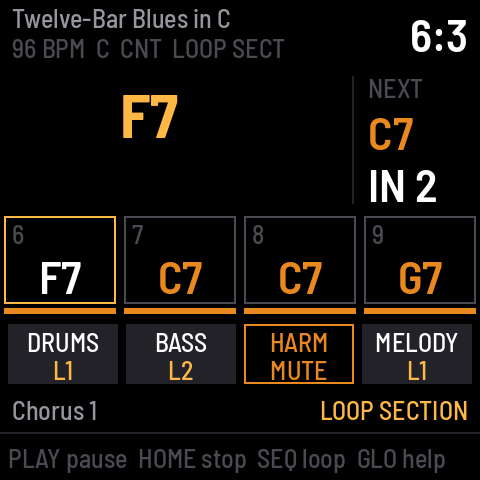

 

Screen, top to bottom: title; tempo, key, CNT, the loop; `bar:beat` (or STOP, PAUSE, IN); the current chord large,
NEXT and a countdown (`IN 3`) in the last bar before a change; the bar strip (this bar and the next 3; no dimming of
a chord held over: the strip shows it is the same chord; an amber line under the bars of a loop, `A` on the start
bar); the beat cursor; the four layers (level `L1`/`L2`, amber `MUTE`); the section, the loop; **the legend**. The
CPU and voices line moved into the help screen.

## Part 3: the part you play (views, key, cue, bass, key lights)

**The part you play** is the muted one of harmony and bass: harmony muted → you play the chords; bass muted (harmony
playing) → you play the bass; **both muted → harmony wins** (the bass notes are still named on the status line).
That is a proposal (plan-M2 G asked for one): one rule for the rhythm cue and the key lights, nothing to set.

- **Key (SAVE, then SELECT).** The whole band but the drums moves; the chord names, the key name and the bass
  names are spelled for the new key (sharps or flats by its signature: F# in D, Gb in Db; C major mixed); the top
  line shows `A (+2)`, amber. A key change while playing ends the sounding notes at once (no note hangs at the old
  pitch).
- **Chord view** (as M1/M2, plus): left of the big chord, the **rhythm cue**: a note symbol for how long the part's
  attack lasts at the chosen level (whole, half, quarter, eighth, sixteenth; read from the song's own events for
  that level), bright for a moment at each attack, grey between; `L1`/`L2` under it. Shown when harmony or bass is
  muted.
- **Keyboard view**: the chord, `next … IN n`, and a keyboard C3–B5 with the chord's keys lit (the voicing of the
  harmony's level: L1 root position, L2 the inversions that move least), the next chord's keys outlined in the last
  bar before it, the bass note amber when the bass is muted.
- **Chart view**: the section's bars (16 a page) with their chords, the bar now framed.
- **Bass names** (the bass muted): the status line shows `BASS C3  then G2` (the note now and the next, in the key
  now, following the bass level).
- **Key lights**: the FM-1's own keys light for the part you play, while playing (and in the count-in, paused):
  harmony → the chord's keys (the level's voicing) bright and the next chord's keys dim in the last bar before a
  change; bass → the bass note. Folded into the 27 keys (F3–G5) and following OCT− / OCT+ (the lit keys are where
  those notes are under your hands). Keys you press light as ever.

 

 

## Why this map

- PLAY pauses, as on most players; stopping is HOME, the "go back" button, which goes one step further when already
  stopped (the list). "Stop and back to the top" is one press.
- SELECT, the big encoder, stays the tempo: the setting changed most while practising.
- PRESETS and ALGORITHM sit side by side under SELECT: left = A (or the coarse step, sections), right = B (or the
  fine step, bars).
- The layer buttons, K1–K4 above them and ARP / SEQ are as in M1 (the user has used them).
- GLO ("global") is the help: one press shows every control where it is on the panel.
- EDIT ("edit what you see") changes the view; SAVE was free and the key is a setting you set and keep for the song
  (the legend says `SAVE: KEY`). A shift (hold GLO + turn) was rejected: GLO opens the help on its press.

## M3 (docs/plan-M3.md), part by part

### Part 1: bug fixes

- **Beat light:** PLAY flashes at full brightness on every beat, for 220 ms on beat 1 and 110 ms on the others.
  M2's mid-level flash on beats 2.. was not visible on the unit.
- **Loop marks:** the strip repeats a loop's bars after its end (it shows the bars as they will be heard). The A and
  B marks are now drawn only on the bars in song order, so there is one A and one B.
- **Start bar after a loop:** setting LOOP BARS (A and B) no longer moves the start point. With the loop off, PLAY
  starts where the start point was set before, and the bottom line says so only if it was set.
- **Count-in in the keyboard and chart views:** the count replaces the view while it counts in, as the chord view
  does.

 

### Part 2: "follow your part" (all four layers), blinking in rhythm

- **Your part** is the muted layer. The top line says so (`BASS - YOURS`), and its box in the layers row says
  YOURS with a double frame. The screen, the rhythm cue, the key lights and the views (EDIT) follow it:
  - **harmony:** the chord (as before);
  - **bass:** the bass note with its octave, the next note, the chord under it; the strip and chart show each bar's
    bass notes;
  - **melody:** the melody note, the next one, the chord; the bars' notes;
  - **drums:** the hit now (KICK, SNARE, ...; another sound of the same hit under the next), the next hit; the strip
    and chart show each bar as a small grid (kick, snare, cymbals, others). Drums have no keyboard view: EDIT skips
    it.
- **Several muted (proposal):** your part is the one muted last. Unmute it and the one muted before takes over. No
  extra control is needed, and the YOURS box shows which one is followed. The M2 "harmony wins" rule is gone.
- **Nothing muted:** the harmony is shown as before (with its cue), and the keys stay dark.
- **Key lights:** your part's keys flash bright at each of its attacks at its level, and stay at the middle
  brightness between attacks. The harmony's next chord is dim in the last bar before it. Drums: no key lights (the
  beat light is enough). The keyboard view does the same: bright amber at an attack, darker amber between, the next
  outlined.
- **Rhythm cue:** always shown (not only when muted), right of the big name, half its M2 height, no level label (the
  layers row has the level).
- Each part remembers its last view (EDIT).

Mock-ups (drawn first):  
  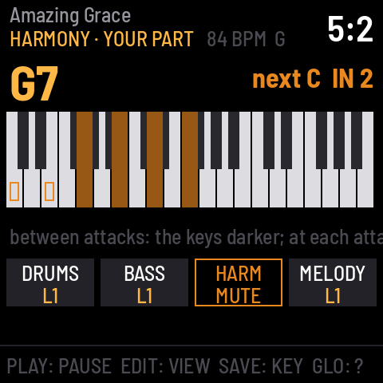

Built (emulator): 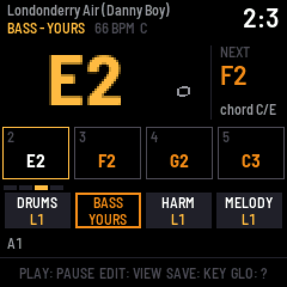 
 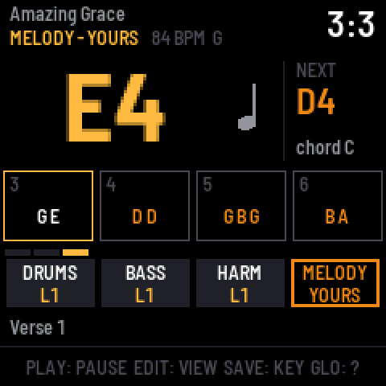 
 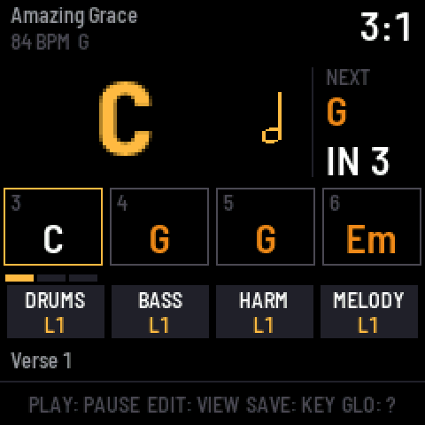

### Part 3: loops redesigned (bars A–B only)

- **One kind of loop:** bars A–B. M2's section loop and whole-song loop are gone: a section is A..B with PRESETS (it
  jumps to section edges), and the whole song is A at the first bar, B at the last.
- **Setting it, step by step** (the legend and a badge on the top line say what to do at each step):
  1. **SEQ:** "LOOP: SET A". A starts at the bar playing (or the start point, stopped). ALGORITHM moves A by a bar,
     PRESETS to a section's first bar.
  2. **SEQ:** A is set; "LOOP: SET B". B starts 4 bars on. ALGORITHM moves it (never before A), PRESETS to a
     section's last bar.
  3. **SEQ:** B is set and the loop is on. Playing outside it, the music jumps in at the next bar line.
  - **HOME** while setting: from B back to A; from A, cancelled (no loop).
  - **SEQ with the loop on:** the loop is off. Nothing else changes it, so there is no hidden state. PRESETS and
    ALGORITHM say "SEQ: OFF FIRST".
- **Shown:** the loop's bars are filled (dark amber) on the strip and the chart, with a line under them, a small A on
  bar A and a small B on bar B. The bar being moved has a white frame. There is exactly one A and one B: the marks
  are only on bars in song order, not on the strip's repeated copies after the loop's end. While A and B are being
  set the loop is not on yet.
- **Start points:** with the loop off, PRESETS = start from a section, ALGORITHM = start from a bar, as before. With
  the loop on, PLAY starts at A (on its beat 1, no pickup).

Mock-ups:  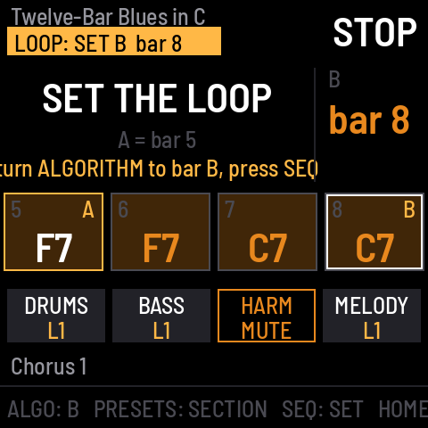
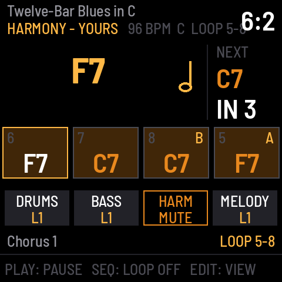

Built:   

### Part 4: screen polish, count-in, inversion label, settings

- **Legend:** button names in amber, actions in gray, a thin divider between pairs (`PLAY pause | EDIT view | ...`),
  on every screen. If a legend is too wide it uses the smaller font.
- **No section row:** the space goes to the views (144 rows, from y 32 to 176). The layers row moves down to 180.
  The start point (`FROM 3`) and the loop (`LOOP 5-8`) are on the top line. The section's name is still in the
  stopped screen and the chart view.
- **Inversion line** (chord view, under the strip): the voicing at the harmony's level, e.g. `C/E, 1st inversion`
  or `G7, root position`, with `L1 root pos.` or `L2 inversions` on the right. For another part: its chord and
  level. The keyboard view has the same line under the keys.
  - Level 1 is always root position; level 2 voice-leads through inversions. On Amazing Grace, 19 of 29 chords at
    level 2 are in an inversion.
- **Keyboard view, zoomed:** 11 white keys (about 1.5 octaves), 21 px each. The window follows your part's notes:
  it moves only when a note now or next would fall outside, with a key to spare. Notes show at their real pitch.
- **Count-in in every view:** the count (and the first chord or note) replaces the view while it counts in. This
  covers the chord, keyboard and chart views, and the later views use the same path.
- **Count-in sound:** a beep on a channel the song does not use: square lead, C6 on beat 1 and G5 on the others,
  70 ms. Its peak is 21x M2's wood-block clicks (7725 against 362 at MASTER 100 %). With no free channel it falls
  back to M2's clicks.
- **Settings (GLO, then GLO again):**
  - SELECT picks a row; ALGORITHM, PLAY or EDIT change its value; GLO or HOME go back and save.
  - The rows: key lights blink ON/OFF; count-in length 1 or 2 BARS; count-in volume LOW, MEDIUM or HIGH (the
    beep's channel volume 64, 96 or 127); note names under the notation ON/OFF (Part 7). Guide volume comes in
    Part 8.
  - Saved in fm1-base's settings store (OBJ_SETTINGS, two copies at 0xFC000 and 0xFD000, the newer valid one wins),
    only when something changed. The stock firmware never uses these sectors: they are all 0xFF in our unit's
    stock dump.
- **Help:** "GLO again: settings".

Mock-ups:  

Built:  
 
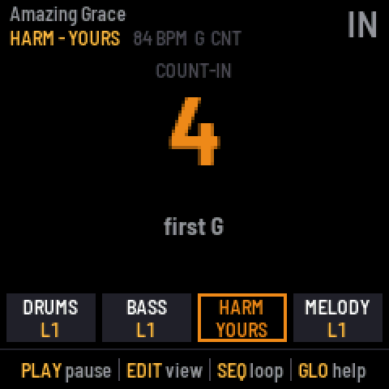

### Part 5: Happy Birthday

Nothing new on the screen: the song is in the list (p5-list.png) and plays from its two-note pickup.

### Part 6: instrument views (guitar chord boxes, bass tab)

EDIT now goes through **each part's own list of views** (the main view first):

| your part | views (EDIT) |
|---|---|
| harmony | chord, keyboard, chart, **guitar** |
| bass | bass note, keyboard, chart, **bass tab**, notation (Part 7) |
| melody | melody note, keyboard, chart, roll and notation (Part 7) |
| drums | the hits, chart, drum grid (Part 7) |

- **Guitar (harmony):**
  - A chord box for the chord now: 6 strings (low E on the left), 4 frets, the dots with finger numbers, o (open)
    and x (not played) above the nut, a barre drawn as a bar. Up the neck, "3fr" marks the first fret. The next
    chord is a small box on the right.
  - Our own table (firmware/app/guitar.h): 53 standard open shapes, slash chords among them (C/E, D/F#, G/B ...),
    and barre shapes for any root from E-form and A-form templates (major, m, 7, m7, maj7, sus4), the lower fret
    of the two.
  - It follows key changes, matching by pitch class, so C# and Db are the same shape. A slash chord with no shape
    of its own shows the plain chord's shape and "the bass plays E".
  - A chord with no shape says "no shape in our table" and lists its notes.
  - tools/guitar_check.py checks every shape's notes against its chord. All the songs' chords, in all 12 keys, find
    a shape (216: 98 open, 82 barre, 36 without their slash bass).
- **Bass tab (bass):**
  - 4 strings (G at the top), the bass part at its level, scrolling to an amber now line. The tab uses the shared
    scrolling engine (Part 7 adds its views to it).
  - Each note is a fret number on the string it is played on (the highest string it is on, the lowest fret), with a
    line for how long it lasts and its name under the tab. Played notes are dim, the sounding one white, coming ones
    amber.
  - About 1.5 bars are on the screen, with bar numbers. Redrawn for every pixel the song moves; the audio is not
    disturbed (the Blues at 250 BPM in this view: on time, no deferred block, CPU at most 14 %).

Mock-ups:  

Built: 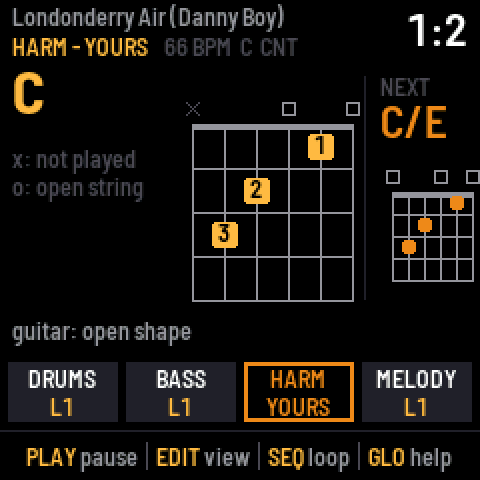 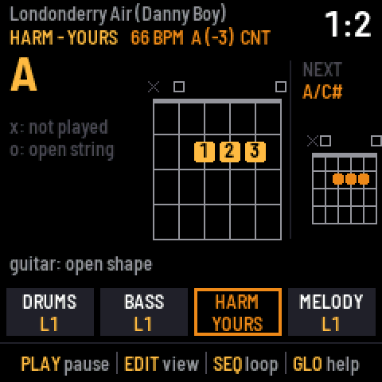
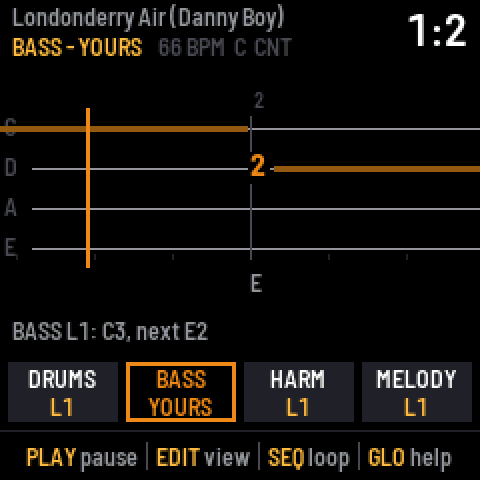

### Part 7: scrolling views (one shared engine, a now line)

All scrolling views share Part 6's engine: the song moves right to left past an amber now line, with bar lines and
beat ticks, and is redrawn for every pixel it moves. The count-in replaces them while it counts, as in every view.

- **Melody roll (melody):**
  - the melody's notes are bars sliding to the line, higher notes higher (the song's melody range at its level, in
    the key now, fills the height);
  - each bar has its name above it, and the chords are along the top;
  - played notes are dim, the sounding one bright, coming ones amber.
- **Notation (melody: treble clef; bass: bass clef), D025, after the approved mock
  (docs/m3-design/notation-mock.png):**
  - one staff with the clef (the mock's treble clef curve; a drawn bass clef with its two dots), the key signature
    and bar lines;
  - noteheads, hollow from a half note up; stems (up below the middle line, down above it); dots; beams for eighth
    pairs on a beat and its "and"; a flag for a lone eighth; ledger lines;
  - accidentals where the note differs from the key signature: sharp, flat or natural;
  - chord names above (the sounding one amber); note names under the staff (setting "Note names", on by default);
  - played notes dim, the sounding one amber, coming ones white;
  - simplifications, as D025 says: each note is drawn as the nearest of whole, dotted half, half, dotted quarter,
    quarter or eighth; no ties, no rests; two notes at once in the part: the first.
  - It follows key changes: Greensleeves at +5 gets one flat.
- **Drum grid (drums):** rows KICK, SNARE, HATS (hi-hats and cymbals), OTHER. The hits are blocks sliding to the line
  at the drums' level; a loud hit is brighter.
- **Zoom (setting "Scrolling views show"):** 1.5 BARS (the default) or 3 BARS, for all the scrolling views (the
  notation at 36 px a beat, or 18).
- The audio is not disturbed: the whole Blues at 250 BPM in the drum grid or the notation is on time, with no
  deferred block and CPU at most 15 %.

Mock-ups:  ; notation: the planning
chat's 

Built:  
 
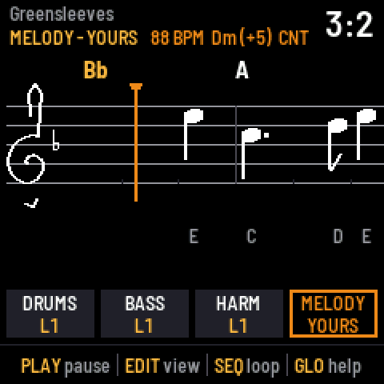 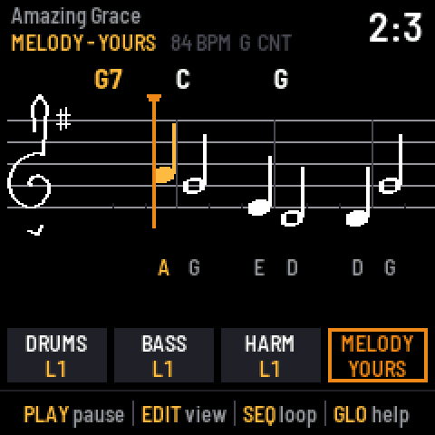

### Part 8: song folders, guide volume

- **Folders (categories):**
  - `category:` in song.yaml (format 1.2) puts each song in a folder. The list opens in **All songs** (as before:
    SELECT, PLAY), and **HOME on the list goes up to the folders**: All songs, then the categories in alphabetical
    order, each with its count. PLAY opens one.
  - Songs without a category (an older 1.1 or 1.0 file, or none given) are in **Other**.
  - Ours: Hymns (Amazing Grace, Saints), Folk (Greensleeves, Danny Boy, Oh! Susanna, Scarborough Fair), Blues,
    Practice forms (Four Chords), Celebrations (Happy Birthday).
  - The FM-1 reads 1.0, 1.1 and 1.2. `fm1song send` asks which versions an FM-1 reads; an M2 FM-1 (up to 1.1) gets
    1.1, without the category. A fallback to M2 needs no special step.
- **Guide volume (setting "Guide (your part)": OFF / 15 % / 30 %):**
  - your part, muted, plays quietly instead of silent, so you can lean on it while learning. Other muted layers stay
    silent;
  - the layers row says GUIDE instead of YOURS;
  - EAS's loudness goes roughly with the square of the velocity, so the velocities are scaled by the square root
    (x 0.39 / x 0.55). In the emulator, 30 % gives 18 % of the part's own level (about −15 dB).

Built:   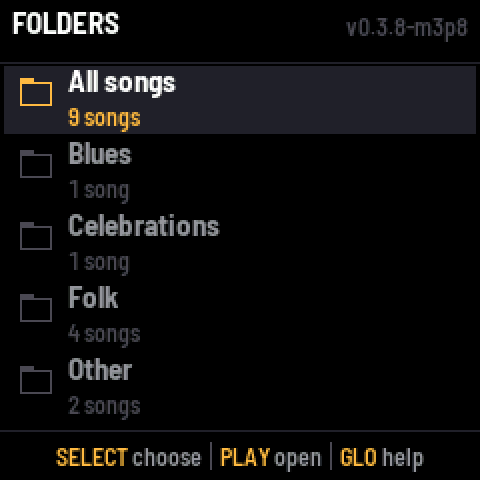
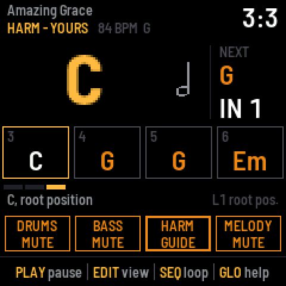

## M4 (docs/plan-M4.md), part by part

### Part 1: quick fixes

- **Count-in volume:** the default is now MEDIUM. A value already saved in the settings stays as it is.
- **The whole-song loop is back** (the user's note), as the first step of SEQ:

  | SEQ press | loop |
  |---|---|
  | 1st (loop off) | **LOOP SONG**: at the end the song goes round again from its first note |
  | 2nd | the song loop off; set A |
  | 3rd | set B: the A–B loop is on |
  | 4th | off |

  With the song loop on, PRESETS and ALGORITHM still set the start point. The top line says `LOOP SONG`, and the
  legend says `SEQ set A-B`.
- **Help on the list** now says `HOME folders`.

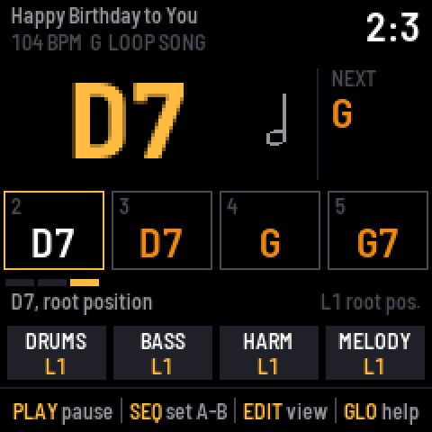 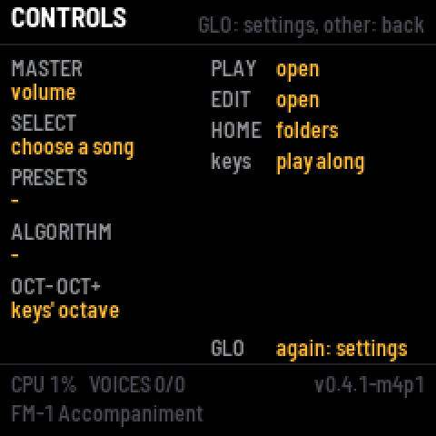

### Part 2: "your part" chosen on purpose (D027)

- **Hold a layer button (FX drums, SEL bass, ENV harmony, LFO melody) for about a second:** that layer becomes your
  part. The top line (`BASS - YOURS`), the big name, the rhythm cue, the key lights and the views follow it,
  **muted or not**. A song opens with the harmony as your part. This replaces M3's "the last one muted".
- **Press a layer button:** its volume cycles **FULL → QUIET → MUTED → FULL**.
  - QUIET plays the layer at the quiet level (setting: 25 % or 50 %, default 50 %). M3's guide volume became this,
    and it works for any layer, not only your part.
  - A press is acted on when the button is released, and only if it was not held.
- **Layer boxes:** the level and FULL or QUIET (QUIET on a darker fill), or MUTE (an amber frame). Your part has an
  amber bar on top and a double frame.
- **Settings:** "Quiet level" 25 % / 50 % and the new "Key lights" ON / OFF (blinking stays a separate setting). There
  are now 7 rows.
- Drums as your part: no key lights.

Mock-up: 

Built: 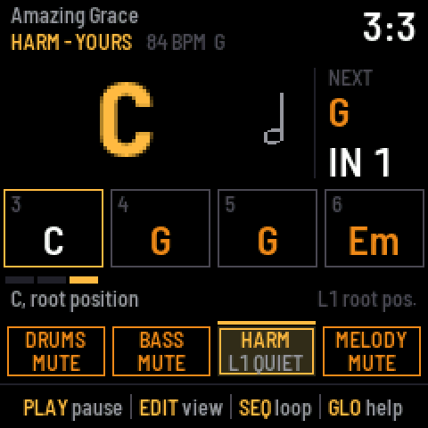 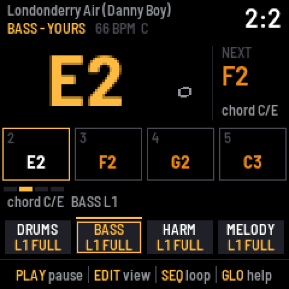

### Part 3: views (harmony notation, two drum views, hiding views)

| your part | views (EDIT) |
|---|---|
| harmony | chord, keyboard, chart, guitar, **notation** (new) |
| bass | bass note, keyboard, chart, bass tab, notation |
| melody | melody note, keyboard, chart, roll, notation |
| drums | **drum grid, drum notation** (only these two now, the user's note) |

- **Harmony notation:**
  - **Staves:** a grand staff, treble and bass with 9 px line spacing. Notes from C4 up go on the treble staff, the
    rest on the bass staff.
  - **Chords:** the harmony at its level, as played. Block chords are stacked on one stem per staff (up on the
    treble, down on the bass); broken chords and arpeggios come out as single notes in time.
  - **Accidentals:** where a note differs from the key signature, e.g. the natural F of G7 in G.
  - **Rest of the page:** chord names above and a now line. The same simplifications as D025 apply: nearest simple
    value, no ties or rests, flags and no beams.
- **Drum notation:** a percussion staff.
  - Kick in the bottom space, low tom, snare in the third space, high tom.
  - Hi-hat above the top line, ride on the top line, crash on a ledger line, the cymbals with x noteheads.
  - The hands' notes of one hit share a stem up; the kick has its own stem down. Values run to the next hit.
- **The drums' other screens are gone**: the main view with the hit names and the chart.
- **Settings → "Views (hide some)" → the Views screen:**
  - every part's views, SHOWN or HIDDEN. SELECT picks one, and ALGORITHM, PLAY or EDIT toggles it;
  - EDIT skips the hidden ones, and a part whose view is hidden opens its first shown one;
  - each layer keeps at least one view ("ONE VIEW MUST STAY");
  - saved with the settings.
  - The saved settings grew: an M3 copy is a different size, so the defaults are used once.
- The settings screen has 8 rows of 22 px.

Mock-ups (written right after the code this time: see LOG): 
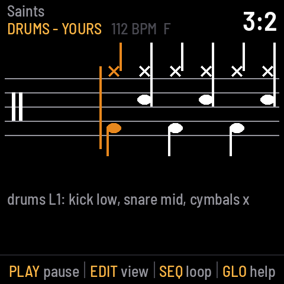 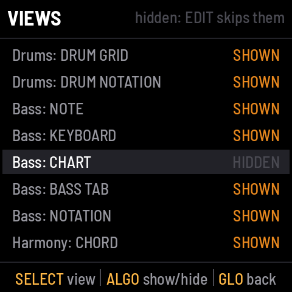

Built: 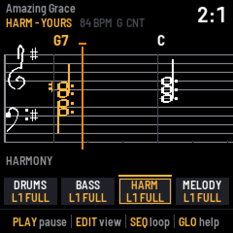 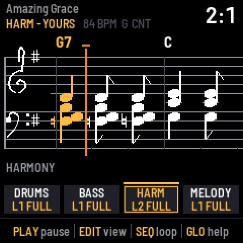
 

### Part 4: five harmony levels (format 1.3)

- **K1 to K4** go from 1 up to as many levels as the song has: now harmony 5, bass 4, drums 3 for all our songs. An
  older song keeps its 2 or 3.
- **Harmony ladder:** L1 block chords held → L2 block chords in the song's rhythm (waltz oom-pah-pah, shuffle,
  stride, ballad quarters, straight eighths) → L3 the same rhythm with inversions (voice leading) → L4 broken chords
  (Alberti in 4/4, low-mid-high in 3/4) → L5 arpeggios across about 1.5 octaves.
- **Bass:** L1 the root held → L2 the root in rhythm → L3 root and fifth → L4 walking (into the next root; the
  boogie line in the blues; root-fifth-octave in 3/4).
- **Drums:** L1 the pulse → L2 a groove → L3 the groove with fills every 4 bars and crashes at the sections.
- **Following the level:**
  - the rhythm cue follows the part's own notes at the level;
  - the inversion line names the level ("L3 inversions", "L5 arpeggio");
  - at **L4 and L5** the key lights and the keyboard view show **each note as it's played** (bright), with the
    chord around it at the middle level (darker in the keyboard view).

 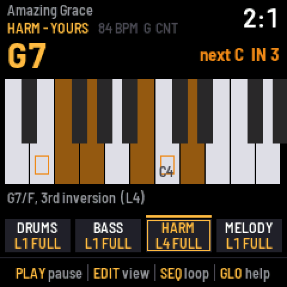
