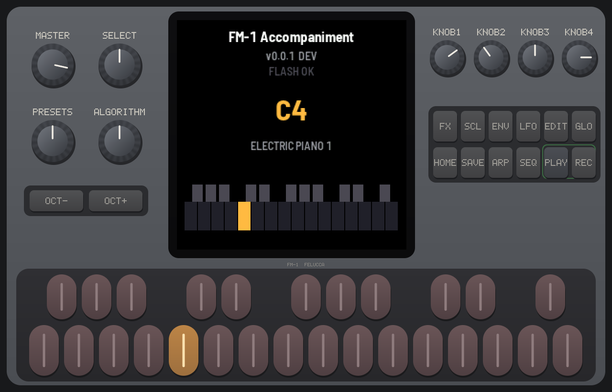

# Our firmware

**On the FM-1 now: M3, v0.4.0-m3 (FM-1_46000400)**, installed by the user 2026-11-05 (LOG). M4 (below) is built,
emulator only; its builds are in `build/step-M4/`.

## Milestone M4 (v0.5.0-m4 = FM-1_46000500; part builds 0.4.N-m4pN)

Plan: docs/plan-M4.md (D026, D027, D004 hybrid). Controls: [controls.md](controls.md), section M4. Tests:
`tools/m4_test.py` (grown from m3_test.py; M3-style layer presses translated; groups m4p1..m4p5). Report:
[step-M4-emulator-report.md](step-M4-emulator-report.md). Import: [import.md](import.md).

| File | M4 changes |
|---|---|
| `firmware/app/ui.c` | the song loop back; your part by holding a layer button, a press cycles FULL / QUIET / MUTED; settings Quiet level, Key lights, Views (hide views); harmony notation (grand staff), drum notation, drums grid + notation only; 5 levels (voicing mapping, L4/L5 lights note by note) |
| `firmware/app/player.c/.h` | player_quiet (any layer, by the square root of the level) |
| `firmware/app/song.c/.h`, `library.c` | format 1.3: 5 variants, 16384 events (decode buffer 128 KiB) |
| `tools/fm1song/arrange.py` | the generators (harmony 1–5, bass 1–4, drums 1–3) for make_songs.py and the importer |
| `tools/fm1song/importer.py`, `cli.py` | `fm1song import`; `send` compiles 1.2 / 1.1 for older FM-1s |
| `songs/make_songs.py` | all 9 songs from arrange.py (Amazing Grace too) |

## Milestone M3 (v0.4.0-m3 = FM-1_46000400; part builds 0.3.N-m3pN = FM-1_460003NN)

Plan: docs/plan-M3.md (D024, D025). Controls, with mock-ups and screens: [controls.md](controls.md), section M3.
Tests: `tools/m3_test.py` (grown from m2_test.py; `--only part1..part8`, a song's slug, store, flash, boot,
practice, views, levels). Report: [step-M3-emulator-report.md](step-M3-emulator-report.md).

| File | M3 changes |
|---|---|
| `firmware/app/ui.c` | Part 2: your part (the last muted layer) drives the screen, cue, key lights (three levels: an attack, between, the next chord) and views. Part 3: the A–B loop set and confirmed with SEQ. Part 4: legend parser (names amber, actions gray, dividers), 144-row views, inversion line, zoomed keyboard (11 white keys following the notes), count-in in every view, settings screen (fm1-base `plat_store`, OBJ_SETTINGS). Part 6: a view list per part, guitar view, the scrolling engine and bass tab. Part 7: melody roll, notation (treble / bass clef, drawn glyphs), drum grid, zoom. Part 8: folders (HOME on the list), guide volume |
| `firmware/app/guitar.h` | our guitar shape table: open shapes, E/A-form barre templates (tools/guitar_check.py checks it) |
| `firmware/app/player.c/.h` | Part 4: the count-in beep (GM square lead on a free channel, 70 ms; volume and 1 or 2 bars); BIAS_BARS 3. Part 8: the guide (a muted layer's velocities x sqrt(level)). Stats version 4 |
| `firmware/app/song.c/.h` | Part 4: chord root and pitch-class accessors. Part 8: format 1.2 (CATG, the category) |
| `firmware/app/library.c` | Part 8: LIST says it reads up to 1.2 |
| `tools/fm1song/` | Part 1: `send` skips non-songs. Part 8: `category`, format 1.2 (`--format 1.2/1.1/1.0`), `send` compiles 1.1 for an older FM-1 |
| `songs/make_songs.py` | Part 1: level-1 drums with a backbeat. Part 5: Happy Birthday. Part 8: categories |
| `tools/mock_m3.py`, `tools/guitar_check.py`, `tools/m3_test.py` | mock-ups, the guitar table check, the emulator tests |


## Milestone M2 (v0.3.0-m2; part builds 0.2.1-m2p1 = FM-1_46000201, ...)

Plan: docs/plan-M2.md (D020, D023). Controls: [controls.md](controls.md).

### Part 1: songs outside the firmware (items 11, 18)

| File | What |
|---|---|
| `firmware/app/store.c/.h` | the song store in the flash data area, 0x97000–0xDBFFF: records written head last, older copies erased after, every erase / write checked against the area (docs/song-format.md 4). Standalone C: `make store-test` runs it on a simulated flash with a power cut at every operation |
| `firmware/app/library.c` | the store on fm1-base's `plat_data*`; the song list (by title); opening a song (the full check, its events decoded into a 64 KiB RAM buffer); the USB commands LIST / SEND / DELETE (fm1-base `APP_USB_CMD`, the update's framing and read requests) |
| `firmware/app/song.c` | reads format 1.1 too: `EZ` chunks (delta-coded events) decoded at open |
| `tools/fm1song/device.py`, `fm1song send / list / delete` | the laptop side; talks only to our firmware (identity `FM-1_46…`) |
| `tools/patches/fm1-emu-usb-host.patch` | fm1-live `FM1_USB_HOST='CMD'`: a program plays the USB host in `--bench` runs (the tests' `fm1song send --emu-pipe`) |
| `tools/m2_test.py` (`make m2-test`), `tools/m2_host.py` | the emulator tests: the store, every song, flash ids |

- **No songs in the image**: 376 KB (M1: 484 KB with 113 KB of songs). The five songs are 45 KB in format 1.1.
- **RAM**: .data+.bss 73.6 of 96 KB; pool 215 of 336 KB (the receive buffer and the decode buffer, 64 KiB each, and
  the list's 64 song headers).
- **Boot never reads a song**: the store is scanned when the list is first drawn; a song is checked in full when
  opened. Empty store: the list says how to send songs. The platform refused the flash chip: `NO SONG STORAGE`.
- **A send** (`fm1song send`): the laptop compiles and checks each song first; the FM-1 stops playing, goes to the
  list, pulls the whole file into RAM (512-byte reads), checks its CRC and runs `song_open` on it, and only then
  writes it (store.c). Sending a song that is there already replaces it (same slug).

### Part 2: practice controls and fixes (items 1–7, 9, 13, 15, B)

Controls and screens: [controls.md](controls.md) (mock-ups first, then the screens: `docs/step-M2/`).

- **Tempo in BPM**, 30–250 (1 a click, 5 when turned quickly); each song opens at its own. The player's position
  is now in units of 1/2,646,000 tick (44,100 frames × 60 s) and a frame adds ppq × BPM: still exact, no drift.
  30 and 250 BPM tested on every song (no block hit the 128-events cap).
- **Start point and loops** (PRESETS / ALGORITHM / SEQ): start from any section (its pickup kept) or bar; loop a
  section, bars A–B, or the song. A loop moved while playing (or one the music is outside of) is jumped to at the
  next bar line. `player_start(tick, count_in)`: the count-in ends where the music starts.
- **Pause / go on** (PLAY), **stop** (HOME; again: the list).
- **Count-in** louder (velocity 127 on beat 1, 104 on the others, the percussion channel at full volume during
  it, the drums' own volume back after): 2.1x M1's peak in the emulator.
- **Beat light**: PLAY's green LED flashes on every beat (bright on beat 1, the mid level on the others), count-in too.
- **Splash** (M10.3): the user's logo (`firmware/assets/src/kickside-logo.jpg` → `tools/logo_to_c.py` with a fixed 7-colour palette, 240×160,
  run-length: 5.6 KB; it has the name in it) at y 36, the version small at the lower right, at least 4 s (the power-on checks come before it and are not
  delayed). The mode screen's mascot is `firmware/assets/src/kickside-mascot.jpg` (120×136, 2.3 KB), drawn 1 : 1.
- **The keys' octave**: OCT− / OCT+ (−3..+3), lit when shifted; a key held while the octave changes is released at
  the note it played.
- **Help** (GLO): every control and what it does; the CPU / voices line moved there. Every screen has a legend.
- **No dimming** of a held-over chord in the bar strip.
- **The "crackle" in Four Chords**: not clipping (every song at L2, MASTER 100 %: peaks 41–59 % of full scale, no
  sample at full scale); the melody's GM 81 "Lead 1 (square)" put 3.8 % of its energy above 8 kHz (aliasing in
  EAS's 22.05 kHz synth); clarinet (GM 72) 0.00 %. Four Chords' melody is now the clarinet (`tools/melody_check.py`).

### Part 3: views and guidance (items 8, 10, 12, F, G)

Controls and screens: [controls.md](controls.md), "Part 3".

- **Transposition** in the player (`player_transpose`): every layer but the percussion channel's, applied as each
  note is sent; the active-note sets hold the notes as sent, so a key change releases exactly what sounds. The UI
  moves to the nearest key (−5..+6) and spells names for the new key's signature (`spell()` in ui.c).
- **Views** (EDIT): chord (with the rhythm cue), keyboard (the harmony level's voicing on C3–B5), chart (the
  section's bars). In every view the chord is drawn ahead of its sound and waits for the LCD's DMA (the tests check
  the keyboard view too).
- **Rhythm cue**: from the part's own events (the harmony's, or the bass's) at the chosen level: the last attack
  at or before the position, how long its notes are held (whole … sixteenth), bright for 140 ms at each attack.
- **Bass names** and **key lights** from the same: the bass note sounding and the next; the chord's voicing (or
  the bass note) folded into the FM-1's 27 keys, with the keys' octave; `plat_lights` (bright, dim) with the keys
  pressed always lit.

## Milestone M1: song list, player, play screen (v0.2.0-m1, identity FM-1_46000200)

Plays the five starter songs (`songs/`, format `fm1-song/1`, docs/song-format.md) with our own scheduler.
Controls: [controls.md](controls.md).

| File | What |
|---|---|
| `firmware/app/song.c/.h` | the compiled-song parser: standalone C, every bound checked at `song_open`, accessors that read in place. Fuzzed on the laptop under ASan/UBSan (`make fuzz`, tools/song_fuzz.c); `song_fuzz --diff` checks it accepts exactly what tools/fm1song's reader accepts |
| `firmware/app/player.c/.h` | the player (D017: our code): per-block scheduler, mutes, variants, tempo, count-in, loops; stats in RAM for the tests |
| `firmware/app/ui.c` | song list and play screen (simple; step 1.6 designs the real ones) |
| `firmware/app/synth.c` | EAS behind a queue; one MIDI stream for the song and the keys; calls `player_block` before each render |
| `tools/songs_to_c.py` | build step (`fm1.toml gen`): compiles every song folder and writes `build/gen/songs_gen.h` (removed in M2; in git at 0bc7c88) |
| `tools/m1_test.py` | headless emulator tests (`make m1-test`): [step-M1-emulator-report.md](step-M1-emulator-report.md) (became tools/m2_test.py) |

How it works:
- **Songs in the build.** The compiled `.fm1s` files are `const` arrays in the app image (the flash, read in
  place through the cache, as Step 0.7's MIDI file was). Chosen over the resource region or the data area because
  it needs no new flash layout and no write path, and the package's own checks cover the songs; the cost is a
  rebuild to change songs, which `fm1song send` (step 1.7) removes. 113 KB for the five songs; the image is
  484 KB of the app slot's ~581 KB. The list peeks at each song's header and META when it is drawn; `song_open`
  (CRC and every check) runs when a song is opened, not at boot. A song that fails shows `SONG ERROR <reason>`.
- **Timing.** `player_block` runs in the audio interrupt before each EAS render (256 frames, 5.8 ms) and sends
  every event whose tick falls before the block's end, at the block's start (≤ one block early, as EAS's own file
  player). The position is a 64-bit count in units of 1/(tempo_us × 441) tick, advanced by 256 × ppq × tempo% ×
  100 per block: exact at 44.1 kHz, so tempo changes (50–120 %) never drift. All 64-bit multiplies are in a
  `noinline` helper (felucca-bsp docs/CPU.md: inlined beside loads they can corrupt a register on this CPU; the
  build's check confirms none is inlined).
- **Mutes, variants, loops, stop.** Each layer's sounding notes are tracked (128-bit set); a mute, a variant
  change, a loop jump or a stop sends exactly their note-offs (and sustain off). A muted layer's note-ons are
  skipped, its controllers still sent; unmuting resumes at the next note.
- **Count-in** (ARP, default on): wood-block clicks for one bar plus the pickup bar's empty beats.
- **Loops** (SEQ: off / song / section): docs/song-format.md 3.3; the screen maps positions past the loop end
  back to its start, so the chord, the countdown and the bar strip show what will be heard.
- **Chord timing.** The big chord is drawn `PL_LEAD_CHORD_MS` (100 ms) ahead of the sound, first in the frame,
  and the frame waits for its DMA to finish before logging it; the beat cursor and countdown use 30 ms. The
  tests check every chord change was on the LCD before the block that played it.

Fallback diagnostic, unchanged: `make hello` (the Step 0.6 hello world).

## Step 0.7: the song-playing PROTOTYPE (v0.1.0-proto, identity FM-1_4600) — history

Replaced in M1 (code removed; in git at 98fc08c). Kept here as the record of what is installed now.

Plays the built-in `songs/amazing-grace` with Sonivox EAS's MIDI file player; four layers mutable; the chord
chart from `song.yaml` on the screen. Prototype code, for Phase 1 to replace: `firmware/app/proto_*.c|h`,
`tools/proto_song_to_c.py`, `tools/proto_test.py`; `app.c` only includes `proto_ui.c`.

| Control | Does |
|---|---|
| PLAY | play from the top / stop (lit green while playing) |
| FX, SEL, ENV, LFO | mute / unmute drums, bass, harmony, melody (lit: the layer plays) |
| MASTER | volume |
| keys | Electric Piano 1 on MIDI channel 16, over the song |
| REC, OCT−, OCT+ | not used: fm1-base's rescues at power-on (below) |

Screen: title, `CPU n%  V now/most` (top left), `bar:beat` and the beats of the bar (top right; bar 0 is the
pickup), the current chord large, the next one below, the four layers (amber outline "MUTE" when muted).

How it works:
- **Song data, at build time:** `fm1.toml gen` runs `tools/proto_song_to_c.py songs/amazing-grace` →
  `build/gen/proto_song.h`: `song.mid`'s bytes as they are, which track plays which layer (variant `:1` of each;
  the other variants' tracks muted for good), and the chord chart (from `song.yaml`: pickup, sections, ending)
  as (tick, chord) pairs, consecutive repeats merged. It refuses a song with tempo or metre changes, a chart that
  does not fit the bars, or a chart that disagrees with `song.mid`'s old `chords` text track (D014 cross-check).
- **Playing from the flash:** `eas/eas_host_fw.c` implements EAS's file calls over an `EAS_FILE` locator's
  `readAt`/`size` (upstream's own interface, `eas_types.h`); the song's locator reads the array in place.
- **Muting:** upstream EAS's per-track mute (`eas_smf.c` `PARSER_DATA_MUTE_FLAGS`), compiled in by
  `JET_INTERFACE` (`eas/eas_options.h`; `jet.c` linked, never used): a muted track's note-ons are dropped, its
  note-offs and controllers still applied; on muting, an all-notes-off on the layer's channel stops held notes.
- **One synth:** the live MIDI stream (keys) is opened on the song stream's synth (`EAS_OpenMIDIStream(…, song)`),
  so the 24 voices are shared and a panic silences both.
- **Threads:** the main loop only sets requests (play/stop counter, mute mask); the audio interrupt applies them
  before each EAS render (`synth.c` calls `pp_before` / `pp_after`), and publishes the position and voices.
- **Chord timing:** the screen runs `PP_LEAD_MS` (80 ms) ahead of the parser's position, to cover a UI frame,
  a blit in progress and the big chord's LCD transfer (~0.32 ms a row); the chord is drawn and sent first.

Tests (then `make proto-test`, removed in M1): `docs/step-0.7-emulator-report.md`.

Fallback diagnostic: `make hello` → `build/hello/fm1acc-hello.fwsc`, the Step 0.6 hello world built from commit
4629478's source (identity FM-1_7100).

## Step 0.6: first build (hello world)



What it does (v0.0.1): shows "FM-1 Accompaniment", its version and whether the flash chip was accepted; each key
plays its own note on General MIDI Electric Piano 1 (Sonivox EAS) at a fixed velocity; the last key pressed is
shown large ("C4"), and a small keyboard lights the held keys.

## Layout

| Path | What | Licence |
|---|---|---|
| `firmware/app/` | our app: `app.c` (includes `ui.c`: screens, controls), `song.c` (parser), `player.c` (scheduler), `synth.c` (EAS behind a queue), `eas/` (our EAS configuration, host layer, small headers), `fm1.toml` (build settings), `words.tsv` (screen reader) | TBD (D017) |
| `firmware/vendor/` | fm1-base + felucca-bsp, Sonivox EAS: see `firmware/vendor/README.md` (commits, licences, our patch) | MPL-2.0, Apache-2.0 |
| `firmware/build.sh` | runs fm1-base's `tools/build.py` on `firmware/app` with the toolchain in `third_party/jieli` | TBD |
| `tools/emu.sh`, `Makefile` | build + emulator in one step | TBD |

## Build and run

```bash
make firmware        # firmware/app/build/fm1acc.fwsc (identity FM-1_4600 from Step 0.7), ~10-20 s
make emu             # build, then play it in the emulator window
make shot            # build, 2.5 s headless with C4 held: build/emu/panel.png, build/emu/audio.raw
make patches         # once after refreshing third_party/fm1-emu: the flash-id patch, rebuilt
```

`FM1_FLASH_ID=b36014 make shot` (or any 6 hex digits) runs it on another flash chip.

Measured 2026-11-04: app image 340,236 B of the ~581 KB slot (EAS + GM set ~240 KB of it); RAM .data+.bss
66,604 of 98,304 B (EAS's pool 40 KB); pool 69,384 of 344,064 B; update loader 8,371 B. In fm1-emu: boots,
1.2–1.4× real time headless; C4 held: rms 1271, silent before, decaying after.

## Flash chip ids

| Chip (`FM1_FLASH_ID`) | App (fm1-base, patched) | Screen | Sound |
|---|---|---|---|
| 0x856014 (Puya, our unit) | flash used | FLASH OK | yes |
| 0xB36014 (UCUN UC25HQ80) | flash used | FLASH OK | yes |
| 0x123456 (unknown) | RAM only: nothing is saved, no crash | FLASH: RAM ONLY (amber) | yes |

The update loader (felucca-bsp, patched) writes only to 0x856014 and 0xB36014: with any other chip it stops with
error -14 **before erasing anything** and stays in update mode (a host sees the update fail; power-cycling returns
to the update loader while the update record is there, so install a known-good package or use the ROM rescue).
Tested in the emulator: app side (all three ids). The loader's refusal is not exercised yet (the emulator test
would need an emulated install).

## Rescue (fm1-base's, kept unchanged)

| How | What happens |
|---|---|
| **REC held at power-on** | "UPDATE MODE (REC)": the chip's own ROM update mode (USB `4c4a:8057`, "WL82 UBOOT1.00"), reachable by jl-uboot-tool / M-Flasher / felucca-bsp `tools/fm1_rescue.py`, even when the app is broken |
| **The app crashes or hangs twice while starting** (within its first 30 s) | **SAFE MODE**: no sound, no app; USB on, so the web installer, `fm1_install.py` and M-UPGRADE can reach it; PLAY tries the app again, REC goes to the ROM update mode; the last crash's PC is shown |
| **Four failed starts** (safe mode failing too) | the ROM update mode by itself |
| **USB soft key** (`F0 22 24 35 7D F7`, e.g. `fm1_unbrick.py softkey`) | the ROM update mode, from the running app, safe mode or the loader |
| **An update cut off** (power or cable lost) | the update loader runs again at the next power-on and the host resumes the install |
| **OCT− and OCT+ held at power-on** | the panel set-up (key/knob calibration), not a rescue |
| **GLO and HOME held at power-on** (ours, M5.1) | **WIPE SONG STORE?** before anything reads the song store: a new PLAY press held 2 s erases every song (settings and firmware stay); HOME or any other button keeps them (the mode screen). Also Settings > Wipe song store, and `tools/fm1song.sh wipe --yes` from the laptop |

The counter of failed starts is cleared by the platform after 30 s of normal running; the app needs no code for it.
Not yet tried on hardware; the emulator does not model the ROM update mode.
