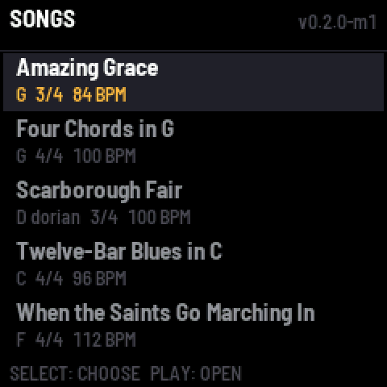
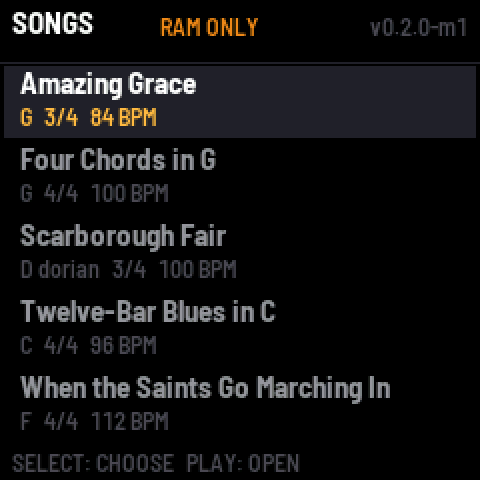
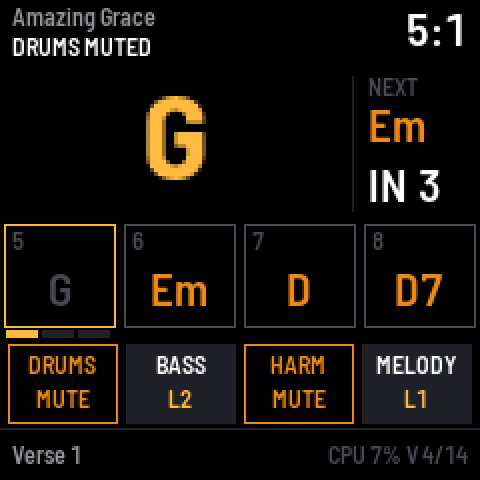
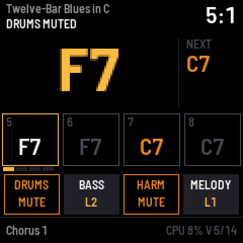
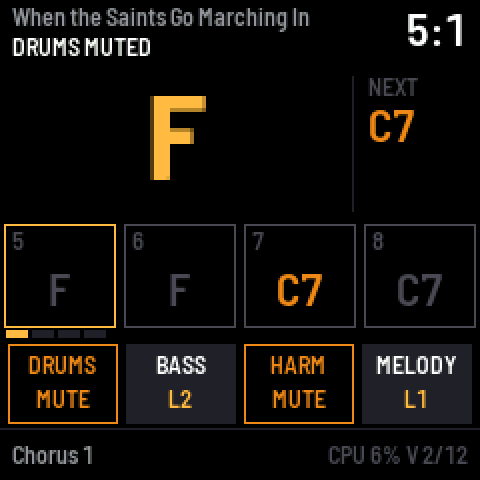
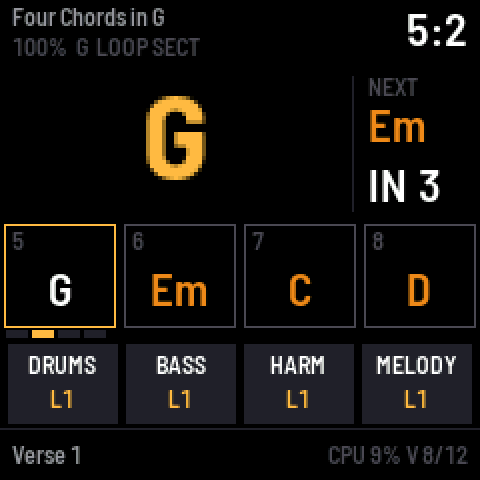
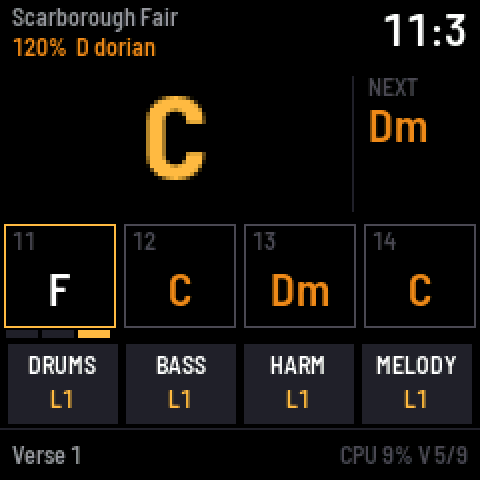

# Milestone M1 — emulator report

Generated by `tools/m1_test.py` (`make m1-test`; here with `--pkg build/step-M1/fm1acc-0.2.0-m1.fwsc`, the
package for the install checklist) in fm1-live, headless, deterministic emulated clock, 2026-11-04. Numbers from
the player's RAM stats (`struct player_stats`, firmware/app/player.h) read from a RAM dump at the end of each run.

How to read the chord check: for each chord change, the frame count when the screen had finished sending the
new chord to the LCD (the frame waits for the DMA) must be no later than the frame count of the audio block that
plays it. It ignores the audio output's own buffering, which only adds margin.

| | |
|---|---|
|  |  |
| song list (flash 856014; b36014 identical) | unknown flash id c84017: RAM ONLY, still plays |
|  |  |
| Amazing Grace, 13 s: bass L2, harmony and drums muted | Blues: bar 4's C7 held over (dimmed); no countdown until the last bar before F7 |
|  |  |
| the Saints, 13 s | Four Chords, LOOP SECT |
|  | |
| Scarborough Fair at 120 % after starting at 50 % | |

Package: build/step-M1/fm1acc-0.2.0-m1.fwsc, sha256 bf8f640f8137efc278fa17f6bcd7c21791eb1adbd68a7b7299c22f851804ff25

## Amazing Grace (amazing-grace)

- PASS: the firmware ran to the end of the run (no halt), stats found
- PASS: played once to the end (starts 1, ends 1)
- PASS: length: 3213056 frames from PLAY to the end, the song predicts 3213001 (count-in + 33 bars at 84 bpm)
- PASS: chord on screen before its sound: 29 of 29 changes, early by 81..99 ms
- PASS: muted layers held back: harmony 12, drums 111 note-ons (sent: drums 15, bass 64, harmony 94, melody 64); mutes that released held notes [0, 0, 1, 0]
- PASS: no EAS voice 1 s after the end (got 0)
- PASS: no block deferred events (got 0)
- PASS: voices at most 14 of 24 (bar index 2); CPU load at most 14 %; longest EAS render 16.2 % of a block
- PASS: sound while playing
- PASS: tempo changed while playing: 14 step(s), 55% 60% 65% 70% 75% 80% 85% 90% 95% 100% 105% 110% 115% 120%
- PASS: position after 882176 frames at those tempos: 14240, exact 14241.0 (no drift)
- PASS: frames played match emulated time: 20004 ms of audio in the 20000 ms since PLAY
- PASS: not at the end yet
- PASS: section loop: 1 jump(s) from tick 24000 to 960 (expected 24000 -> 960: section 'Verse 1' minus its 480-tick lead-in)
- PASS: after the jump, inside the loop (tick 12205)
- PASS: no voices left by a stop
- screens: amazing-grace-screen.png (at 13000 ms: bass L2, harmony and drums muted), amazing-grace-loop.png, amazing-grace-tempo.png

## Four Chords in G (four-chords)

- PASS: the firmware ran to the end of the run (no halt), stats found
- PASS: played once to the end (starts 1, ends 1)
- PASS: length: 3492608 frames from PLAY to the end, the song predicts 3492720 (count-in + 32 bars at 100 bpm)
- PASS: chord on screen before its sound: 28 of 28 changes, early by 81..99 ms
- PASS: muted layers held back: harmony 9, drums 219 note-ons (sent: drums 34, bass 242, harmony 87, melody 80); mutes that released held notes [1, 0, 1, 0]
- PASS: no EAS voice 1 s after the end (got 0)
- PASS: no block deferred events (got 0)
- PASS: voices at most 12 of 24 (bar index 1); CPU load at most 13 %; longest EAS render 14.6 % of a block
- PASS: sound while playing
- PASS: tempo changed while playing: 14 step(s), 55% 60% 65% 70% 75% 80% 85% 90% 95% 100% 105% 110% 115% 120%
- PASS: position after 882176 frames at those tempos: 15810, exact 15810.7 (no drift)
- PASS: frames played match emulated time: 20004 ms of audio in the 20000 ms since PLAY
- PASS: not at the end yet
- PASS: section loop: 1 jump(s) from tick 15360 to 0 (expected 15360 -> 0: section 'Verse 1' minus its 0-tick lead-in)
- PASS: after the jump, inside the loop (tick 8551)
- PASS: no voices left by a stop
- screens: four-chords-screen.png (at 13000 ms: bass L2, harmony and drums muted), four-chords-loop.png, four-chords-tempo.png

## Scarborough Fair (scarborough-fair)

- PASS: the firmware ran to the end of the run (no halt), stats found
- PASS: played once to the end (starts 1, ends 1)
- PASS: length: 2619392 frames from PLAY to the end, the song predicts 2619540 (count-in + 32 bars at 100 bpm)
- PASS: chord on screen before its sound: 26 of 26 changes, early by 81..93 ms
- PASS: muted layers held back: harmony 15, drums 103 note-ons (sent: drums 24, bass 61, harmony 81, melody 70); mutes that released held notes [1, 0, 1, 0]
- PASS: no EAS voice 1 s after the end (got 0)
- PASS: no block deferred events (got 0)
- PASS: voices at most 9 of 24 (bar index 1); CPU load at most 10 %; longest EAS render 11.4 % of a block
- PASS: sound while playing
- PASS: tempo changed while playing: 14 step(s), 55% 60% 65% 70% 75% 80% 85% 90% 95% 100% 105% 110% 115% 120%
- PASS: position after 882176 frames at those tempos: 15810, exact 15810.7 (no drift)
- PASS: frames played match emulated time: 20004 ms of audio in the 20000 ms since PLAY
- PASS: not at the end yet
- PASS: section loop: 1 jump(s) from tick 23040 to 0 (expected 23040 -> 0: section 'Verse 1' minus its 0-tick lead-in)
- PASS: after the jump, inside the loop (tick 11627)
- PASS: no voices left by a stop
- screens: scarborough-fair-screen.png (at 13000 ms: bass L2, harmony and drums muted), scarborough-fair-loop.png, scarborough-fair-tempo.png

## Twelve-Bar Blues in C (twelve-bar-blues)

- PASS: the firmware ran to the end of the run (no halt), stats found
- PASS: played once to the end (starts 1, ends 1)
- PASS: length: 4079104 frames from PLAY to the end, the song predicts 4079250 (count-in + 36 bars at 96 bpm)
- PASS: chord on screen before its sound: 25 of 25 changes, early by 81..99 ms
- PASS: muted layers held back: harmony 12, drums 252 note-ons (sent: drums 32, bass 274, harmony 132, melody 90); mutes that released held notes [0, 0, 1, 0]
- PASS: no EAS voice 1 s after the end (got 0)
- PASS: no block deferred events (got 0)
- PASS: voices at most 14 of 24 (bar index 1); CPU load at most 14 %; longest EAS render 17.0 % of a block
- PASS: sound while playing
- PASS: tempo changed while playing: 14 step(s), 55% 60% 65% 70% 75% 80% 85% 90% 95% 100% 105% 110% 115% 120%
- PASS: position after 882176 frames at those tempos: 15178, exact 15178.3 (no drift)
- PASS: frames played match emulated time: 20004 ms of audio in the 20000 ms since PLAY
- PASS: not at the end yet
- PASS: section loop: 1 jump(s) from tick 23040 to 0 (expected 23040 -> 0: section 'Chorus 1' minus its 0-tick lead-in)
- PASS: after the jump, inside the loop (tick 11533)
- PASS: no voices left by a stop
- screens: twelve-bar-blues-screen.png (at 13000 ms: bass L2, harmony and drums muted), twelve-bar-blues-loop.png, twelve-bar-blues-tempo.png

## When the Saints Go Marching In (saints)

- PASS: the firmware ran to the end of the run (no halt), stats found
- PASS: played once to the end (starts 1, ends 1)
- PASS: length: 3212800 frames from PLAY to the end, the song predicts 3212998 (count-in + 33 bars at 112 bpm)
- PASS: chord on screen before its sound: 15 of 15 changes, early by 81..99 ms
- PASS: muted layers held back: harmony 13, drums 221 note-ons (sent: drums 30, bass 63, harmony 91, melody 66); mutes that released held notes [0, 0, 1, 0]
- PASS: no EAS voice 1 s after the end (got 0)
- PASS: no block deferred events (got 0)
- PASS: voices at most 12 of 24 (bar index 3); CPU load at most 13 %; longest EAS render 14.5 % of a block
- PASS: sound while playing
- PASS: tempo changed while playing: 14 step(s), 55% 60% 65% 70% 75% 80% 85% 90% 95% 100% 105% 110% 115% 120%
- PASS: position after 882176 frames at those tempos: 18187, exact 18188.0 (no drift)
- PASS: frames played match emulated time: 20004 ms of audio in the 20000 ms since PLAY
- PASS: not at the end yet
- PASS: section loop: 1 jump(s) from tick 31200 to 480 (expected 31200 -> 480: section 'Chorus 1' minus its 1440-tick lead-in)
- PASS: after the jump, inside the loop (tick 15468)
- PASS: no voices left by a stop
- screens: saints-screen.png (at 13000 ms: bass L2, harmony and drums muted), saints-loop.png, saints-tempo.png

## Flash chip ids (Amazing Grace)

- 856014: halt False, sound rms 1073, stats found
- b36014: halt False, sound rms 1073, stats found
- c84017: halt False, sound rms 1073, stats found
- PASS: 856014 and b36014 show the same list screen
- PASS: unknown id c84017 shows RAM ONLY (flash-list-c84017.png) and still plays

**ALL PASS**
