# Milestone M2 — emulator report and budget

Package: `build/step-M2/final/fm1acc-0.3.0-m2.fwsc`, identity **FM-1_46000300**, v0.3.0-m2, from commit `2e470ed`,
sha256 `0294089be99c6e07aeaecba8aedc749097642aa8522b48ff597ff1c6177ac52d`.
`tools/m2_test.py` on **this exact package** in fm1-emu (fm1-live, patched: `tools/apply_patches.sh`): **175 checks,
ALL PASS** (`build/step-M2/final/report.md`, screens in `build/step-M2/final/emu/`). Laptop-only tests: the song store
with a power cut at every operation (`tools/store_test.sh`: ALL PASS), the compiler (71 pytest tests), the parser
fuzzed 10 minutes under ASan/UBSan (Part 1: 3.1 M files, no report; song.c unchanged since).

Part builds, each tested the same way when made: `build/step-M2/part1/` (0.2.1-m2p1, 96 checks), `part2/`
(0.2.2-m2p2, the early checklist's), `part3/` (0.2.3-m2p3, 175 checks; parts 3 and 4).

## What was tested (by item)

| Item | How (emulator unless said) | Result |
|---|---|---|
| 11, 18 songs in the flash, format 1.1 | all 8 sent over emulated USB (`fm1song send`), stored byte for byte; list; empty store; junk in the area; a damaged stored song; damaged files sent unchecked; a stalled transfer; power cuts at 6 points of a send; flash ids 856014 / b36014 / unknown | PASS (8 songs: 77,888 B, 3.8 s emulated, 22 of 69 sectors) |
| 1 tempo in BPM | every song at 30 then 250 BPM (45 steps): position exact, no deferred events; own BPM on opening | PASS (CPU ≤ 15 %) |
| 2 splash | the logo at 2.8 s, the list at 3.3 s; PLAY ignored meanwhile; OCT−+OCT+ / REC held at power-on still fm1-base's | PASS |
| 4 count-in | velocities 127 / 104, peak 2.1× M1's | PASS |
| 5, 15 loops, start points | from a section, from a bar, LOOP BARS 3–4, a section loop moved while playing; every song's section loop | PASS |
| 13 pause | pause (silent, released), go on with / without count-in, HOME stop then list | PASS |
| 6 strip | no dimming (screens) | — |
| 7 crackle | not clipping (all songs: peaks 41–58 %, 0 samples at full scale); the square lead aliased (3.8 % > 8 kHz) → clarinet (0.0 %) | PASS |
| 9 OCT | +2 → C4 plays 84; −5 → clamped at −3 | PASS |
| B beat light | 4 bright + 9 flashes in 8 s at 96 BPM | PASS |
| 8 key | +2: bass, harmony, melody up 2, drums unchanged; reset per song; change while playing: no hanging note | PASS |
| 12 views | EDIT: keyboard, chart; chords drawn before their sound in the keyboard view | PASS |
| G key lights | harmony muted: the voicing's keys; with OCT+: moved; bass muted: its note | PASS |
| 10, F cue, bass names | screens (`view-chord-cue.png`) | — |
| E three songs | each: played to the end on time, chords on time, levels, 30/250 BPM, loops | PASS |

## Per song (own tempo, the full run)

| Song | Length vs prediction | Chord ahead of sound | Voices (of 24) | CPU | Peak at L2, MASTER 100 % |
|---|---|---|---|---|---|
| Amazing Grace | +56 frames | 81–99 ms | 14 | 14 % | 45 % |
| Four Chords in G | −112 | 81–99 | 12 | 12 % | 44 % |
| Greensleeves | −19 | 64–99 | 12 | 10 % | 55 % |
| Londonderry Air | −76 | 87–99 | 11 | 12 % | 48 % |
| Oh! Susanna | −64 | 81–99 | 13 | 13 % | 50 % |
| Scarborough Fair | −148 | 81–99 | 9 | 10 % | 41 % |
| Twelve-Bar Blues | −146 | 58–99 | 14 | 14 % | 58 % |
| Saints | −200 | 81–99 | 12 | 13 % | 45 % |

(Length: within one 256-frame block of the prediction.)

## Budget

| | M1 | M2 | Room |
|---|---|---|---|
| App image (flash, slot ~581 KB) | 484 KB (113 KB songs) | **395,232 B** (no songs; logo 4.4 KB; the views ~9 KB) | ~186 KB |
| RAM .data+.bss (of 98,304) | 66,604 | **74,276** | 24 KB |
| RAM pool (of 344,064) | 69,384 | **215,048** (song receive 64 KiB, decode 64 KiB, 64 song headers) | 129 KB |
| Song store (flash data area) | — | 69 sectors; the 8 songs use 22 | 47 sectors (~25 more songs of this size) |
| CPU (audio load, worst bar) | 14 % | 15 % (250 BPM) | |
| Voices | 14 | 14 of 24 | |

## Screens (this package)

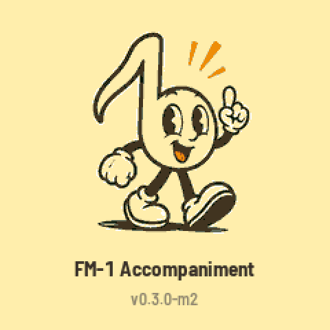 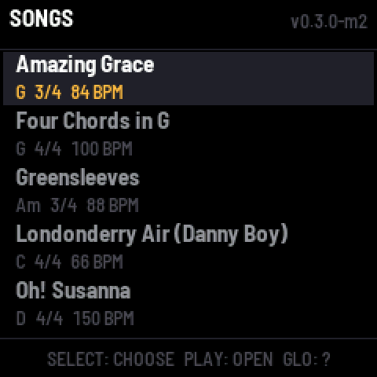 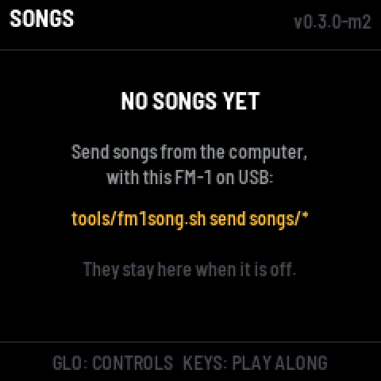
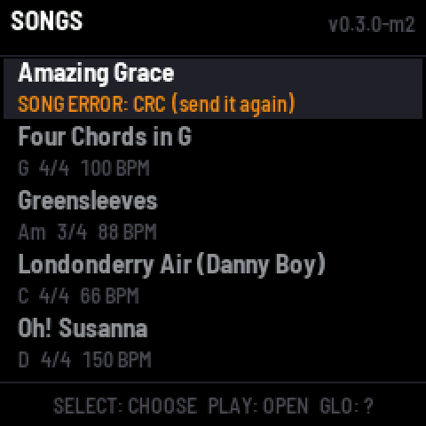 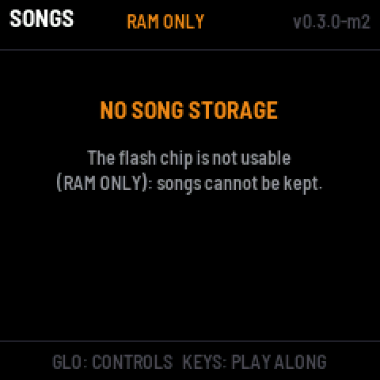 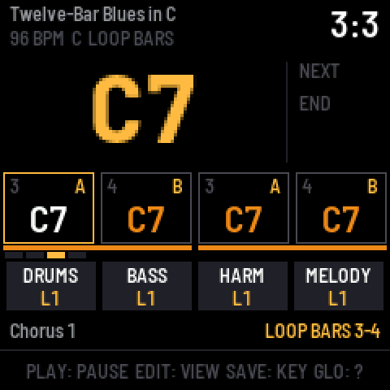
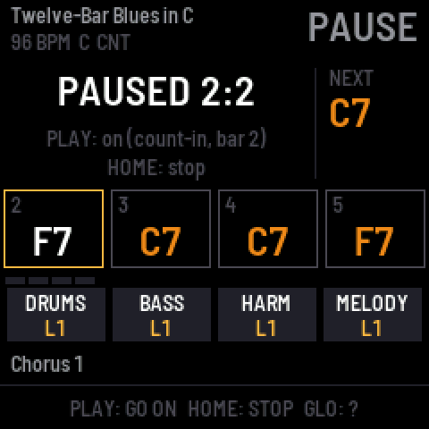 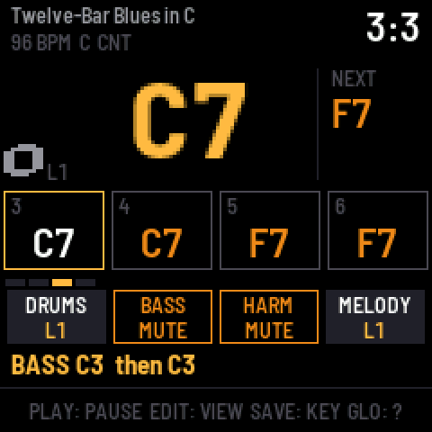 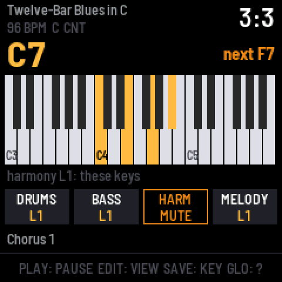
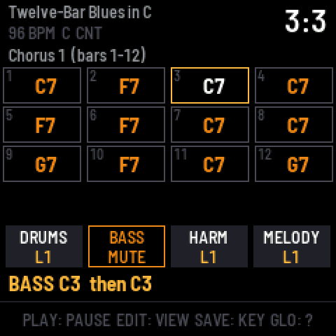 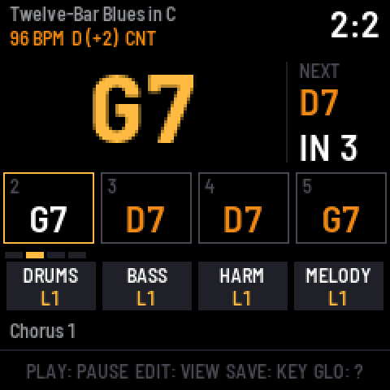

## Not covered by the emulator

How it sounds and feels (the clarinet, the louder count-in, the cue's flash), the real LEDs and key lights, the
real USB song send (only the emulated one), and the melodies typed from memory (a person should check them).
